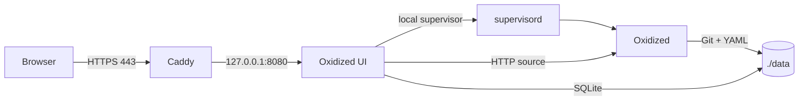

<p align="center">
  
</p>

<h1 align="center">Oxidized UI</h1>

<p align="center">
  <strong>A clean, self-hosted control plane for Oxidized network configuration backups.</strong>
</p>

<p align="center">
  <a href="https://github.com/Alexmysterio/oxidized-ui/actions/workflows/ci.yml"></a>
  <a href="https://github.com/Alexmysterio/oxidized-ui/actions/workflows/contract.yml"></a>
  
  
  
  
</p>

<p align="center">
  <a href="#quick-start"><strong>Quick start</strong></a> ·
  <a href="#what-you-get"><strong>Features</strong></a> ·
  <a href="#configuration-reference"><strong>Configuration</strong></a> ·
  <a href="#troubleshooting"><strong>Troubleshooting</strong></a> ·
  <a href="SECURITY.md"><strong>Security</strong></a>
</p>

Oxidized UI turns [Oxidized](https://github.com/ytti/oxidized) into a complete
backup workspace: inventory, encrypted credentials, configuration history,
diff and rollback, scheduling, audit, metrics, and notifications. The default
distribution runs **Oxidized, the web UI, and Caddy in one Docker container**.

It uses a private local certificate authority, so no public certificate or
external certificate service is required. It is intended for a home lab, a small
office, or a trusted internal network.

> [!WARNING]
> **Development status.** Oxidized UI is under active development. Features may
> change or break, and bugs may cause data loss or downtime. Use it at your own
> risk. The author accepts no responsibility or liability for any damage, data
> loss, outage, misconfiguration or other harm resulting from its use. Test in a
> lab and keep independent backups.
>
> **AI-assisted development.** Parts of the code and documentation were produced
> with the help of generative AI tools. The result is reviewed and tested, but
> errors are still possible.

<p align="center">
  
  <br>
  <em>Login screen. The interface is available in English and Spanish.</em>
</p>

## At a glance

| 🗂️ Inventory | 🔐 Security | 📊 Operations |
|---|---|---|
| Nodes, groups, models, credentials, CSV import/export with preview, bulk edit, saved filters, and node-to-node diff. | Argon2id passwords, TOTP with QR setup, recovery codes, session revocation, IP allowlist, API tokens, OIDC, and encrypted secrets. | Backups by node, group or site, persistent jobs, live logs, SLA, history, audit, Prometheus, multi-channel alerts, and encrypted export. |
| **⚙️ Configuration** | **🧭 Visibility** | **🐳 Deployment** |
| YAML editor, validation, preflight, apply, health check, rollback, and scheduled maintenance windows. | Dashboard with failed-node triage, per-node status, version history, golden versions, diffs, backup timeline, and group-level success rate. | One image by default. A four-container hardened mode is available for stricter isolation. |

> **New to Docker?** Follow the [Quick start](#quick-start) step by step. Every
> command is shown explicitly. You do not need to understand the internals to get
> a working installation.

---

## Contents

- [What you get](#what-you-get)
- [How it works](#how-it-works)
- [Requirements](#requirements)
- [Quick start](#quick-start)
- [Everyday use](#everyday-use)
- [Configuration reference](#configuration-reference)
- [Persistent data and backups](#persistent-data-and-backups)
- [Updating and resetting](#updating-and-resetting)
- [Secure multi-container mode](#secure-multi-container-mode)
- [Certificates explained](#certificates-explained)
- [Notifications](#notifications)
- [Backup schedules](#backup-schedules)
- [Nodes, tags and templates](#nodes-tags-and-templates)
- [Reconciliation](#reconciliation)
- [Sites](#sites)
- [MFA and profile](#mfa-and-profile)
- [Golden versions](#golden-versions)
- [Queue priority and pacing](#queue-priority-and-pacing)
- [System health and reports](#system-health-and-reports)
- [Automatic retries](#automatic-retries)
- [Maintenance windows](#maintenance-windows)
- [Compliance](#compliance)
- [Scoped operators](#scoped-operators)
- [Notification digests](#notification-digests)
- [Scheduled encrypted export](#scheduled-encrypted-export)
- [API tokens](#api-tokens)
- [OIDC login](#oidc-login)
- [Incoming webhooks](#incoming-webhooks)
- [Metrics](#metrics)
- [Encrypted export](#encrypted-export)
- [Troubleshooting](#troubleshooting)
- [Security notes](#security-notes)
- [Development](#development)
- [License](#license)
- [Known limitations](#known-limitations)

---

## What you get

- Web inventory of Oxidized nodes.
- Per-node configuration history and side-by-side diffs.
- Credentials stored write-only and encrypted with Fernet.
- Users with `admin`, `operator`, and `viewer` roles.
- Password policy, account lockout, IP allowlist, MFA/TOTP with scannable QR
  setup for every role, and revocable sessions. Disabling MFA or changing a
  password also revokes API tokens, and a token can never exceed the current role
  of its owner.
- Restart/reload of Oxidized from the UI.
- Configuration editor with validation, preflight, diff, apply, health check,
  and rollback.
- Scheduled configuration apply and backup schedules by group.
- Automatic retries with backoff, maintenance windows and configuration-change alerts.
- Golden-config compliance per group or model with line-level diffs.
- Golden version pinning per node, with a badge and one-click diff against the
  current version.
- Group-scoped operators, saved filters and favorite nodes.
- Manual and scheduled backups with a persistent, cancellable job queue.
- Per-site backups from the site card or the map popup.
- Bulk connection tests, config sanity warnings (empty, truncated or command-error
  output) and CSV import preview before applying changes.
- Dashboard failed-node triage with the latest reason and a retry action.
- Backup history, success rate, and SLA by group.
- Prometheus metrics.
- Audit log with CSV export.
- Outgoing alerts to Telegram, Slack, Discord, or any webhook, plus an incoming backup webhook.
- Optional daily notification digest.
- Node tags, node templates, and inventory facts (serial, OS version, uptime).
- Sites view grouped by tag, with per-site coordinates, owner/contact/notes, review
  tracking, and an OpenStreetMap map. Every node in a site is listed in its marker
  popup.
- Reconciliation with Oxidized: missing nodes, orphans and field drift.
- Queue priority rules and pacing for bulk backups.
- System health history, weekly CSV/PDF reports and email delivery.
- Audit entries with before/after values per node edit.
- Scheduled encrypted export to SFTP or S3, with bundle verification.
- Custom site name and logo, user avatars, and full name/email on user profiles.
- API tokens for automation.
- Optional generic OIDC login.
- English and Spanish interface.
- One Docker image by default; a hardened four-container mode is optional.

---

## How it works

### Default: one image, one container

The container runs three processes under `supervisord`:

```text
+--------------------------------------------------------------+
| oxidized-ui container                                        |
|                                                              |
|  supervisord (root)                                          |
|    +-- Caddy          HTTPS :80/:443 -> UI :8080             |
|    +-- oxidized-ui    FastAPI + React, 127.0.0.1:8080        |
|    +-- oxidized       Oxidized engine, 127.0.0.1:8888        |
|                                                              |
|  Data: ./data/ui, ./data/config, ./data/oxidized             |
+--------------------------------------------------------------+
```



Only ports `80` and `443` are published to the host. The UI and Oxidized API
stay inside the container. There is no Docker socket and no Docker socket proxy
in this mode. The UI controls Oxidized through the local `supervisord` API, so
restarting Oxidized does not restart the whole container.

### Alternative: four-container mode

`docker-compose.secure.yml` runs Caddy, the UI, Oxidized, and a read-only Docker
socket proxy in separate containers. This provides stronger process isolation but
requires more resources and the Docker socket proxy. See
[Secure multi-container mode](#secure-multi-container-mode).

---

## Requirements

- A computer that is always on (mini PC, server, or desktop).
- Docker Engine with Docker Compose v2.
- At least 2 GB of free RAM and about 2 GB of free disk space.
- A hostname or IP address for the service.
- TCP ports `80` and `443` available on the host.
- Network access from the container to your devices (SSH/Telnet).

The default image is based on `oxidized/oxidized:latest` and includes Caddy and
`supervisord`. The UI uses Python/FastAPI; the frontend is React/TypeScript.

---

## Quick start

The examples use:

```text
oxidized.example.com
```

Replace it with a name you control, such as `oxidized.home.arpa`,
`oxidized.lan`, or `backups.example.net`. For same-computer access,
`oxidized.local` also works if you add it to your hosts file.

### 1. Install Docker

Install Docker Engine or Docker environment for your platform, including the Compose
v2 plugin. Follow the official Docker installation instructions for your system.

Check that both commands work:

```bash
docker --version
docker compose version
```

Your user must have permission to run Docker. If `docker` requires elevated
privileges on your system, configure access according to your Docker installation.

### 2. Download only the compose file

You do not need to clone the repository. Create a directory and download the
single compose file:

```bash
mkdir oxidized-ui
cd oxidized-ui
curl -fsSLO https://raw.githubusercontent.com/Alexmysterio/oxidized-ui/main/docker-compose.yml
```

If `curl` is not available, open that URL in a browser and save the file as
`docker-compose.yml` in the new directory.

The image is pulled from:

```text
ghcr.io/alexmysterio/oxidized-ui:latest
```

### 3. Configure the hostname

All settings can be placed in a `.env` file next to `docker-compose.yml`. Copy the
example:

```bash
curl -fsSLO https://raw.githubusercontent.com/Alexmysterio/oxidized-ui/main/.env.example
mv .env.example .env
```

Or edit the values directly in `docker-compose.yml`.

At minimum, change:

```env
UI_HOSTNAME=oxidized.example.com
```

The basic deployment serves one hostname. Use `UI_HOSTNAME` for either a DNS
name or the server IP; a second hostname is not required.

The name must resolve to the Docker host. Configure a DNS record, or add it to
the hosts file of the clients that will access the UI. For same-computer access,
point it to loopback; for LAN access, point it to the host's LAN address.

Verify resolution:

```bash
nslookup oxidized.example.com
```

The result must be the Docker host. If it is a public address and you are not
forwarding ports, the browser will not reach Caddy.

The secrets are optional:

- leave `SECRET_KEY`, `FERNET_KEY`, and `OXIDIZED_SOURCE_TOKEN` empty on a new
  installation; they are generated automatically and stored in
  `data/ui/.runtime-secrets`;
- set them explicitly when reusing an existing database or restoring a backup.

#### Using an IP address and non-standard ports

If the server is `192.168.1.111`, you do not need a domain. Use:

```env
UI_HOSTNAME=192.168.1.111
UI_HTTP_PORT=8888
UI_HTTPS_PORT=4433
```

You do not need `TRUSTED_ORIGINS`: the current image derives the allowed origins
from `UI_HOSTNAME` and `UI_HTTPS_PORT`.

The port mapping becomes:

```text
host 8888 -> container 80   (HTTP, redirects to HTTPS)
host 4433 -> container 443  (HTTPS)
```

Allow TCP `8888` and `4433` in the host firewall. Ports `80` and `443` on the
host are not used.

Open:

```text
https://192.168.1.111:4433
```

`http://192.168.1.111:8888` redirects to the HTTPS URL with port `4433`.

The certificate is issued for the IP address. Import the exported CA into the
client trust store, or accept the browser warning while testing.

### 4. Start the service

```bash
docker compose up -d
```

Docker pulls the published image and starts one container. Check:

```bash
docker compose ps
docker compose logs -f oxidized-ui
```

Wait for `healthy`. Test the internal health endpoint:

```bash
docker compose exec oxidized-ui python3 -c "import urllib.request; print(urllib.request.urlopen('http://127.0.0.1:8080/api/health').read().decode())"
```

Expected:

```json
{"status":"ok","database":"ok","config_writable":true,"setup_required":true}
```

`setup_required: true` means no administrator exists yet.

Open:

```text
https://oxidized.example.com
```

Use `https://`, not `http://`. Port `8080` is not published.

### 5. Trust the local certificate

Caddy creates a private CA. Browsers warn until that CA is trusted. Traffic is
still encrypted, but importing the CA removes the warning and prevents accepting
a wrong certificate.

Export the public CA:

```bash
docker cp oxidized-ui:/data/caddy/caddy/pki/authorities/local/root.crt ./oxidized-ui-ca.crt
```

It is also available on the host at:

```text
data/ui/caddy/caddy/pki/authorities/local/root.crt
```

Install `oxidized-ui-ca.crt` as a trusted root CA in the certificate store used
by your browser or operating environment. The exact menu and command depend on
your platform. If your browser has its own certificate store, import it there as
well.

For a quick test only:

```bash
curl -k https://oxidized.example.com/api/health
```

Do not use `-k` for normal operation.

### 6. Create the first administrator

Open `https://oxidized.example.com` and complete the setup wizard: username,
password, language. The password policy is enforced. After setup,
`setup_required` becomes `false`.

Optionally, set in `.env`:

```env
BOOTSTRAP_ADMIN_USERNAME=admin
BOOTSTRAP_ADMIN_PASSWORD=change-this-password
BOOTSTRAP_ADMIN_LANGUAGE=en
```

Remove the password from `.env` after the first start. The wizard is usually
easier and safer.

On a brand-new installation the dashboard reports:

```text
Oxidized is waiting for its first node. Add a node to start the engine.
```

Oxidized stays stopped until the inventory has at least one node. This is
expected; use **Nodes -> Add node**, then **Backup now**.

### 7. Add your first device

1. Open **Nodes -> Add node**.
2. Fill in:
   - **Name:** a unique name, e.g. `core-switch`.
   - **Address:** device IP or DNS name.
   - **Model:** Oxidized model, e.g. `ios`, `junos`, `routeros`.
   - **Group:** optional; groups can share credentials.
   - **Input:** usually `ssh`.
   - **Port:** usually `22`, or the device's SSH port.
   - **Username/password:** credentials Oxidized will use.
3. Save.
4. Open the node and select **Test connection** (ping, TCP, SSH, authentication).
5. If the host key is unknown, verify the fingerprint and select **Trust host
   key**.
6. Select **Backup now**.

The device must be reachable from the container, not only from your desktop.


---

## Full compose file

This is the exact, minimal `docker-compose.yml` used by the standalone
installation. If you downloaded it with `curl`, you do not need to copy it again.
Only `UI_HOSTNAME` and the optional ports need changing; secrets and internal
paths are handled by the image.

```yaml
name: oxidized-ui

# Minimal standalone installation.
#
#   mkdir oxidized-ui && cd oxidized-ui
#   curl -fsSLO https://raw.githubusercontent.com/Alexmysterio/oxidized-ui/main/docker-compose.yml
#   # set UI_HOSTNAME below, or create .env
#   docker compose up -d
#
# Optional advanced variables can be added to .env. See the README table.
# Secrets are generated automatically under ./data/ui/.runtime-secrets.

services:
  oxidized-ui:
    image: ghcr.io/alexmysterio/oxidized-ui:latest
    container_name: oxidized-ui
    restart: unless-stopped
    env_file:
      - path: .env
        required: false
    ports:
      - "${UI_HTTP_PORT:-80}:80"
      - "${UI_HTTPS_PORT:-443}:443"
    environment:
      UI_HOSTNAME: ${UI_HOSTNAME:-oxidized.example.com}
      UI_HTTPS_PORT: ${UI_HTTPS_PORT:-443}
    volumes:
      - ./data/ui:/data
      - ./data/config:/oxidized-config
      - ./data/oxidized:/var/lib/oxidized
    # Allow the unprivileged UI process (UID/GID 30000) to send ICMP pings.
    sysctls:
      net.ipv4.ping_group_range: "30000 30000"
    security_opt:
      - no-new-privileges:true
```

---

---

## Everyday use

- **Dashboard:** Oxidized status, node counts, recent activity, SLA by group,
  active jobs, onboarding hints, and failed-node triage with the latest reason and
  retry action.
- **Nodes:** search, filters, saved filters, bulk backup/group/field/delete,
  bulk connection test, CSV import with preview and export, ICMP ping, connection
  test, host-key trust, versions, golden version, diff, and history. The node
  detail shows effective connection values and where each one comes from: node,
  group model, group, model, or global configuration. The configuration tab warns
  about empty, truncated or command-error output.
- **Sites:** grouped inventory, site coordinates, owner/contact/notes, last review,
  per-site backup and an OpenStreetMap map whose popup lists every node.
- **Configuration:** validate YAML, preflight, diff, apply, health check, and
  rollback. Scheduled apply supports maintenance windows.
- **Operations:** backup schedules and jobs in the **Backups** section; live logs
  and container health in **Status and logs**.
- **Audit:** filter and export CSV; retention is separate from backup history.
- **Users and profile:** roles, sessions, password, MFA with QR setup, language,
  theme, full name, email, profile photo, and API tokens.
- **System settings:** connections, security, retention, branding, and
  notification channels.

---

## Configuration reference

Everything user-facing is configured in `docker-compose.yml` or in a `.env` file
next to it. The compose file sets safe defaults, so a new installation only
needs `UI_HOSTNAME`.

Secrets are optional on a fresh installation: if `SECRET_KEY`, `FERNET_KEY`, and
`OXIDIZED_SOURCE_TOKEN` are empty, the container generates them and stores them
in `data/ui/.runtime-secrets`. Set them explicitly when reusing an existing
database or restoring a backup.

### Compose variables

| Variable | Default | Required | Purpose |
|---|---|---|---|
| `UI_HOSTNAME` | `oxidized.example.com` | Yes | Primary hostname or IP; must match the certificate. |
| `UI_HTTP_PORT` | `80` | No | Host port for HTTP; redirects to HTTPS. |
| `UI_HTTPS_PORT` | `443` | No | Host port for HTTPS; also used in the HTTP redirect and trusted origins. |
| `TZ` | `UTC` | No | IANA timezone for the container. |
| `DEFAULT_LANGUAGE` | `es` | No | Initial UI language (`en` or `es`). |
| `UI_LOG_LEVEL` | `INFO` | No | UI log level. |
| `SECRET_KEY` | generated | No | Session/CSRF signing key. |
| `FERNET_KEY` | generated | No | Key for encrypted credentials. |
| `OXIDIZED_SOURCE_TOKEN` | generated | No | Shared token for the internal Oxidized source. |
| `BOOTSTRAP_ADMIN_USERNAME` | empty | No | Optional first administrator. |
| `BOOTSTRAP_ADMIN_PASSWORD` | empty | No | Optional first administrator password. |
| `BOOTSTRAP_ADMIN_LANGUAGE` | `en` | No | Language for the bootstrap administrator. |
| `METRICS_TOKEN` | empty | **Yes** | Bearer token for `/api/metrics`. The endpoint returns 401 until it is set. |
| `INBOUND_WEBHOOK_TOKEN` | empty | No | Token for `POST /api/hooks/backup`. |
| `OIDC_ENABLED` | `false` | No | Show the OIDC login button. |
| `OIDC_ISSUER` | empty | OIDC only | Issuer URL with a discovery document. |
| `OIDC_CLIENT_ID` | empty | OIDC only | OIDC client ID. |
| `OIDC_CLIENT_SECRET` | empty | OIDC only | OIDC client secret. |
| `OIDC_REDIRECT_URI` | empty | OIDC only | Exact callback URL. |
| `OIDC_SCOPES` | `openid profile email` | No | OIDC scopes. |
| `OIDC_DEFAULT_ROLE` | `viewer` | No | Role for auto-created OIDC users. |
| `OIDC_AUTO_CREATE` | `true` | No | Create unknown OIDC users. |
| `CONFIG_BACKUP_KEEP` | `0` | No | YAML backup count; `0` keeps all. |

### Container and advanced variables

These are normally set by the image and should only be changed if you know why.

| Variable | Default | Purpose |
|---|---|---|
| `SESSION_COOKIE_SECURE` | `true` | HTTPS-only session cookie. |
| `TRUST_PROXY_HEADERS` | `true` | Trust Caddy forwarded headers. |
| `TRUSTED_ORIGINS` | derived | Optional override; normally derived from `UI_HOSTNAME` and `UI_HTTPS_PORT`. Only needed behind a different reverse proxy. |
| `DATA_DIR` | `/data` | SQLite, sessions, audit, Caddy state. |
| `OXIDIZED_CONFIG_DIR` | `/oxidized-config` | Oxidized config and `known_hosts`. |
| `STATIC_DIR` | `/app/static` | Built frontend files. |
| `LOCALES_DIR` | `/app/locales` | Translation files. |
| `OXIDIZED_API_URL` | `http://127.0.0.1:8888` | Internal Oxidized API. |
| `UI_INTERNAL_URL` | `http://127.0.0.1:8080` | Internal UI source URL. |
| `SUPERVISOR_URL` | `http://127.0.0.1:9001/RPC2` | Local supervisor RPC. |
| `SUPERVISOR_PROGRAM` | `oxidized` | Process controlled by the UI. |
| `SUPERVISOR_LOGFILE` | `/var/log/supervisor/oxidized.log` | Oxidized log file. |
| `APP_ENV` | `production` | Enables production behavior. |
| `APP_VERSION` | `0.1.0` | Read-only application version. |
| `AUTO_MIGRATE` | `true` | Run Alembic migrations at startup. |
| `DISABLE_BACKGROUND_TASKS` | `false` | Disable poller/background workers. |
| `DATABASE_URL` | empty | Override SQLite with another SQLAlchemy URL. |
| `POLL_INTERVAL_SECONDS` | `30` | Oxidized polling interval. |
| `SESSION_ABSOLUTE_HOURS` | `12` | Maximum session lifetime. |
| `SESSION_IDLE_MINUTES` | `30` | Idle session timeout. |
| `SESSION_COOKIE_NAME` | `oxidized_ui_session` | Session cookie name. |
| `LOGIN_MAX_FAILURES_PER_USER` | `5` | Login failures before user lockout. |
| `LOGIN_MAX_FAILURES_PER_IP` | `20` | Login failures before IP lockout. |
| `LOGIN_WINDOW_MINUTES` | `15` | Failure-count window. |
| `OXIDIZED_CONNECT_TIMEOUT` | `4` | Oxidized connect timeout in seconds. |
| `OXIDIZED_READ_TIMEOUT` | `60` | Oxidized read timeout in seconds. |
| `DOCKER_CONNECT_TIMEOUT` | `3` | Docker API connect timeout. |
| `DOCKER_READ_TIMEOUT` | `60` | Docker API read timeout. |
| `MAX_CONFIG_BYTES` | `1000000` | Maximum config revision size. |
| `MAX_CSV_BYTES` | `5000000` | Maximum CSV import size. |
| `MAX_CSV_ROWS` | `25000` | Maximum CSV import rows. |
| `MAX_LOG_LINES` | `5000` | Maximum log snapshot lines. |
| `OXIDIZED_CONTAINER_NAME` | `oxidized` | Container name in secure mode. |
| `DOCKER_PROXY_URL` | `http://docker-socket-proxy:2375` | Docker proxy in secure mode. |

### Secure-mode-only variables

These belong to `docker-compose.secure.yml` and `.env.secure.example`:

| Variable | Default | Purpose |
|---|---|---|
| `UI_BIND_ADDRESS` | `127.0.0.1` | Host address for the internal UI port. |
| `UI_PORT` | `8080` | Host port for the internal UI. |
| `OXIDIZED_IMAGE` | `oxidized/oxidized:latest` | Oxidized image tag. |
| `SOCKET_PROXY_IMAGE` | `tecnativa/docker-socket-proxy:latest` | Docker socket proxy image tag. |

Applying a configuration while the inventory is empty now saves the revision
without restarting Oxidized. Oxidized starts automatically when the first node is
added and loads the already-applied configuration. This makes it possible to
create and apply a group before adding nodes.

### Managed configuration blocks

The configuration form hides fields that are owned by the console. They are not
locked by a permission: they are generated on every apply and cannot be edited
safely.

Managed blocks (hidden from the form):

- `source.default=http`
- `source.http.url`
- `source.http.headers`
- `source.http.map`
- `source.http.vars_map`
- `extensions.oxidized-web.load`
- `extensions.oxidized-web.listen`
- `extensions.oxidized-web.port`
- `extensions.oxidized-web.url_prefix`

The source block is how Oxidized receives the inventory from the console. The
`oxidized-web` extension provides the local API used for status, versions,
configuration fetch, reload, and restart. The backend injects these values on
every apply. If they are changed in YAML, the save is rejected with
`config.managed_key_modified`; if changed outside the console, the next apply
overwrites them.

Manage inventory through **Nodes** and **Groups**, the internal URL through the
container environment, and keep the managed blocks untouched. Editable
neighbours such as `source.http.read_timeout`,
`extensions.oxidized-web.vhosts`, and
`extensions.oxidized-web.hide_node_vars` remain available.

### Settings managed from the UI

These are stored in SQLite and changed under **System settings** or **Profile**,
not in `.env`:

| Setting | Default | Where |
|---|---|---|
| Activity retention | `0` (keep all) | System settings |
| Audit retention | `180` days | System settings |
| Password minimum length | `12` | System settings |
| Password complexity | enabled | System settings |
| Password history | `5` | System settings |
| IP allowlist | empty (allow all) | System settings |
| Poll interval | `30` seconds | System settings |
| Log tail default | `500` lines | System settings |
| YAML backup retention | `0` (keep all) | System settings |
| Notification channels | empty | System settings |
| Stale-backup threshold | `0` (disabled) | System settings |
| Site name | `Oxidized UI` | System settings |
| Logo | default mark | System settings |
| User language/theme | per user | Profile |
| User full name/email | empty | Profile or Users |
| User avatar | empty | Profile |

## Persistent data and backups

The default compose uses these host directories:

| Host path | Container path | Contents |
|---|---|---|
| `./data/ui` | `/data` | SQLite, sessions, audit, avatars, branding, Caddy CA/certificates |
| `./data/config` | `/oxidized-config` | Oxidized config, `known_hosts`, `.ui-backups`, crashes |
| `./data/oxidized` | `/var/lib/oxidized` | Git repository with device configurations |

They survive `docker compose down`, recreation, and upgrades. `data/` is excluded
from Git.

### Backup

Stop the container so SQLite has no pending writes:

```bash
docker compose stop oxidized-ui
tar -czf oxidized-ui-backup-$(date +%F).tar.gz data .env
docker compose start oxidized-ui
```

Store `.env` and the backup securely: they contain the Fernet key and encrypted
credentials.

### Restore

Stop the container, replace `data/` and `.env` with the backup, then:

```bash
docker compose up -d
```

Use the same `FERNET_KEY` that was used when the backup was created.

### Encrypted export

Administrators can use **System settings -> Export encrypted** to download an
AES-256-GCM `.oxui` file protected by a passphrase. It contains SQLite, the
Oxidized configuration, `known_hosts`, YAML backups, branding, avatars, the
Fernet key, and metadata. The passphrase is not stored.

Restore offline:

```bash
docker compose stop oxidized-ui
python scripts/restore_encrypted_export.py backup.oxui --yes
# Put the printed FERNET_KEY into .env
docker compose start oxidized-ui
```

Without `--yes`, the script only validates and lists the archive contents.
There is intentionally no live HTTP import.

---

## Updating and resetting

### Update

```bash
docker compose pull
docker compose up -d
```

Data stays in `./data`; database migrations run automatically. Back up first.

### Reset everything (destructive)

This removes users, nodes, history, Git data, configuration, and the CA:

```bash
docker compose down
rm -rf data
docker compose up -d
```

After a reset, a new CA is generated and must be trusted again.

---

## Secure multi-container mode

If you prefer process isolation:

```bash
cp .env.secure.example .env
# edit .env
docker compose -f docker-compose.secure.yml up -d --build
```

Do not run both modes at once; they use the same container names and host ports.

In secure mode:

- UI, Oxidized, Caddy, and the Docker socket proxy are separate containers.
- The Docker socket is mounted only in the proxy, read-only.
- Caddy is the only service publishing ports.
- The UI restarts Oxidized through the proxy.
- Named volumes replace `./data` bind mounts.

The CA path in secure mode is:

```text
oxidized-ui-caddy:/data/caddy/pki/authorities/local/root.crt
```

See `docker-compose.secure.yml` and `.env.secure.example`.

---

## Certificates explained

Caddy creates a private root CA, a server certificate for `UI_HOSTNAME` and
`UI_HOSTNAME` signed by that CA, and renews the server certificate automatically.
Clients trust the root CA once.

If the CA is not imported, the browser warns, but TLS still encrypts traffic. On
a shared or production network, import the CA.

The certificate is valid only for the configured names. A different hostname or
IP will not match. Do not copy the CA private key; only export `root.crt`. The
private key remains in `data/ui/caddy`.

Deleting `data/` creates a new CA; every client must trust it again.

## Notifications

Open **System settings -> Notifications** and add one or more channels:

- **Telegram:** bot token and chat ID.
- **Slack:** incoming webhook URL.
- **Discord:** webhook URL.
- **Generic webhook:** any HTTPS endpoint that accepts a JSON POST.

Each channel can subscribe to **job failures**, **stale backups**, or both.
Every channel has its own **Send test** button; the global test sends to all
enabled channels. Channel configuration is encrypted with `FERNET_KEY`. The old
single webhook setting is migrated automatically to a generic webhook channel.

---

## Backup schedules

Open **Backups** in the sidebar:

- pick a group, or **All groups** (includes ungrouped nodes);
- choose an interval in minutes;
- create the schedule.

A schedule enqueues an immediate config read (`next` in Oxidized) for the nodes
in scope every N minutes. It does not replace the Oxidized interval: Oxidized
already reads every device on the interval configured in the YAML. A schedule is
only useful to request extra reads on a different cadence, for example every 6 h
for a critical group while the global interval is 24 h. If the schedule uses the
same or a slower cadence than Oxidized, it adds nothing — the console warns you
in that case. Every run is recorded in the job history and audit log. The poller
runs due schedules and, if another bulk backup is queued or running, retries in a
few minutes without marking the schedule as executed.

Schedules can be paused and re-timed in place from the same page.

---

## Nodes, tags and templates

Nodes accept free-form tags (for example `site=madrid`, `criticality=high`,
`vendor=cisco`). The console always stores tag keys and values with the first
letter upper-cased, and the editors suggest keys and values already in use. Tags
are metadata used by the console to filter, group actions and match queue-priority
rules; they are not written to the Oxidized YAML. Tag a selection in bulk from the
nodes table or edit them per node.

**Node templates** (Inventory -> Templates) store the reusable part of onboarding:
model, group, input, port, username, output, prompt, timeout and vars. Creating a
node from a template asks only for the name and address; credentials are inherited
from the group or added afterwards.

**Inventory facts** are extracted from the current configuration on demand (single
node or a selection): serial number, software version and uptime. They are shown
on the node detail page and included in the global search, so a serial number
finds its node.

---

## Reconciliation

**Inventory -> Reconciliation** compares Oxidized's live inventory with the
console database:

- **Missing in the console**: present in Oxidized but not managed here; import the
  selected ones in bulk (model, address and group are copied when the group exists).
- **Orphans**: present in the console but not loaded by Oxidized; review before deleting.
- **Drift**: address, group or model differ between both sides.

The console remains the source of truth for configuration; reconciliation only
reports and offers the import.

---

## Sites

**Inventory -> Sites** groups the inventory by a tag (default `Site`) and shows the
aggregated status per location. Coordinates, owner, contact, notes and the last
review date belong to the site, not to individual nodes: use the pencil on a site
card to edit them. The coordinate input accepts decimal values
(`36.751112, -3.491751`) or degrees/minutes/seconds (`36°45'04.0"N 3°29'30.3"W`).
The search box filters by site name, owner, contact or notes. **Back up site**
queues every node in that site from the card or from the map popup.

All nodes with that site tag are listed in the site's marker popup, so overlapping
devices remain accessible. Tiles are proxied and cached by the backend (they are
fetched from OpenStreetMap, never from the browser), so clients on isolated VLANs
still get the map background. At startup, legacy node coordinate tags are moved to
the corresponding site and removed from the nodes.

---

## MFA and profile

**Profile -> Two-step verification** shows a scannable QR code generated from the
TOTP secret, plus a collapsible manual key for clients that cannot scan it. Confirm
one code to enable MFA and save the recovery codes that are shown once. The same
page manages language, theme, full name, email, profile photo and API tokens.

The avatar is used in the top bar and in the sidebar footer, with the user's
initials as fallback.

---

## Golden versions

In a node's **Versions** tab, the star button pins one version as the golden
reference. The table marks it with a **Golden** badge and offers **Compare with
golden**, which opens the diff against the current version. Pinning is metadata
only: it does not restore, apply or roll back a configuration.

---

## Queue priority and pacing

**Backups -> Queue priority** maps a group or a tag to a priority from 1 (highest)
to 10. The priority is resolved when a job is created and used by the internal
priority queue, so critical devices are not stuck behind a bulk run. Matching rules
use the lowest number.

**System -> Bulk backup pacing** sets how many nodes are queued per batch and how
long to wait between batches. This prevents a full-inventory backup from hitting
hundreds of devices at once.

---

## System health and reports

**Status & logs** shows disk usage, database size, Oxidized data size, queue depth,
failed jobs today and the applied migration, with configurable warning thresholds.
It also keeps hourly samples for seven days (disk and database sparklines, largest
nodes). Threshold alerts use the `system.health` event and only fire after N
consecutive checks, so a single spike does not page anyone.

**System -> Weekly reports** generates a CSV and a PDF with backup success/failure
per node, failed jobs, configuration changes, the compliance summary and the
comparison against the previous week. Reports are stored under `data/reports`,
pruned to the configured retention, downloadable from the UI, uploaded to the
export target when configured, and emailed (CSV+PDF) when SMTP is configured.
The `report.ready` event notifies subscribed channels.

Audit entries for node edits include `before` and `after` values for every changed
non-secret field (plus password/enable presence), and the audit page can filter by
target type and target ID.

The encrypted export page also has **Verify**: it builds and decrypts a bundle to
check the ZIP, database, metadata and Fernet key are intact.

---

## Automatic retries

When a node's latest outcome is a failure, the console schedules a retry with
exponential backoff (initial delay and maximum attempts are configured in
**System**). The node detail page shows the pending retry. When attempts are
exhausted the retry loop stops and, if a channel subscribes to
`backup.retry_exhausted`, a notification is sent. Nodes inside a maintenance
window are skipped.

---

## Maintenance windows

**Maintenance** pauses the console's automated work for a node, a group, or every
node during a time range:

- scheduled and automatic-retry backups are skipped;
- stale and configuration-change alerts are muted;
- node detail shows a maintenance banner.

Oxidized keeps polling on its own interval; maintenance only controls what the
console triggers and reports.

---

## Compliance

**Compliance** compares each node's current configuration against a reference
template and reports compliant, deviating or missing-template nodes, with a
line-level diff. Templates can be global, per group, or per model; the most
specific one wins (group, then model, then global).

Templates are plain text and are stored in the console database. The comparison
runs on demand and reads the current configuration through Oxidized.

---

## Scoped operators

Users with the `operator` or `viewer` role can be restricted to a list of groups.
Restricted users only see their nodes in the inventory, search, dashboard node
actions and the API; direct access to a node outside their scope returns 404 and
bulk actions are intersected with their scope. Administrators always see
everything.

---

## Notification digests

Each channel can opt into a daily digest. At the configured hour (in the system
timezone) the console sends a single message with failed jobs, failed backups and
configuration changes from the last 24 hours instead of one alert per event.
Configuration changes are detected from the Oxidized output and notified through
the `config.changed` event.

---

## Scheduled encrypted export

**System → Scheduled encrypted export** uploads the same encrypted `.oxui` bundle
as the manual export to SFTP or S3 on a schedule, or on demand with **Run now**.
The passphrase is stored encrypted with `FERNET_KEY`; keep a copy of it, because
it is required to restore the bundle. For SFTP, set the server's SHA256 host-key
fingerprint (or preload it in `known_hosts`); uploads and remote verification
refuse unknown or changed host keys. **Verify** downloads the newest remote bundle
and checks its ZIP, database, metadata and key; it falls back to a local self-test
when no target is configured.

---

## API tokens

In **Profile -> API tokens**, choose a name, role, and expiry. The token is shown
once. Use it as:

```bash
curl -H "Authorization: Bearer oxui_..." https://oxidized.example.com/api/nodes
```

Tokens are stored hashed; the role cannot exceed the user's role. Revoke at any
time.

---

## OIDC login

Set the `OIDC_*` variables and restart. A **Sign in with OIDC** button appears.
Create this redirect URI in your provider:

```text
https://oxidized.example.com/api/auth/oidc/callback
```

The flow uses authorization code + PKCE and the `userinfo` endpoint. The state is
bound to an HttpOnly cookie. New users are created as `oidc_<hash-of-subject>` with
`OIDC_DEFAULT_ROLE`; they do not use a local password. If a user has local MFA
enabled, the OIDC callback redirects to the login page with an MFA challenge and
asks for the TOTP or recovery code, so the second factor cannot be bypassed. Test
with your provider before relying on it.

---

## Incoming webhooks

Set `INBOUND_WEBHOOK_TOKEN`, restart, then:

```bash
curl -X POST https://oxidized.example.com/api/hooks/backup \
  -H "X-Webhook-Token: $INBOUND_WEBHOOK_TOKEN"
```

Responses: `202` accepted; `409` global backup already active; `403` wrong token;
`404` webhook not configured. No cookies or CSRF; the token is the auth.

---

## Metrics

`/api/metrics` is authenticated with `METRICS_TOKEN`; without it the endpoint
returns 401 (node names and status are not public). Configure it before scraping:

```bash
curl -H "Authorization: Bearer $METRICS_TOKEN" https://oxidized.example.com/api/metrics
```

Prometheus text format includes node status, last successful backup time, 24-hour
backup counts/ratio, job counts, and stale-node count.

---

## Troubleshooting

### Docker pull returns unauthorized

The Git repository and the GitHub Container Registry package have separate
visibility settings. If `docker compose up` reports `unauthorized`, open the
container package settings and set the package visibility to **Public**:

```text
https://github.com/users/Alexmysterio/packages/container/package/oxidized-ui/settings
```

GitHub does not provide an API to change container package visibility. This is
a one-time repository administration step, not a configuration value.

### Setup fails with `auth.origin_rejected`

This happens when the browser origin does not match the configured HTTPS
hostname and port. For a server at `192.168.2.25` exposed on host port `3443`,
set both:

```env
UI_HOSTNAME=192.168.2.25
UI_HTTPS_PORT=3443
```

and recreate the container:

```bash
docker compose up -d --force-recreate
```

Open the UI at the exact URL:

```text
https://192.168.2.25:3443
```

Changing only the `ports` mapping is not enough: `UI_HTTPS_PORT` also controls the
HTTP redirect and the derived origin. Use `docker compose config` to confirm
`UI_HOSTNAME` and `UI_HTTPS_PORT`.

Current images derive `TRUSTED_ORIGINS` automatically. Older images may still
require an explicit `TRUSTED_ORIGINS=https://192.168.2.25,https://192.168.2.25:3443`.

### Browser cannot connect

1. Container healthy?

```bash
docker compose ps
```

2. Hostname resolves to the Docker host?

```bash
nslookup oxidized.example.com
```

3. Internal health okay?

```bash
docker compose exec oxidized-ui python3 -c "import urllib.request; print(urllib.request.urlopen('http://127.0.0.1:8080/api/health').read().decode())"
```

4. Caddy answers?

```bash
curl -k https://oxidized.example.com/api/health
```

If loopback works but the LAN address does not, check Docker port publishing and the host firewall.

### Certificate warning

- Use `https://`, not `http://`.
- The hostname must match `UI_HOSTNAME`.
- Import the CA into the certificate store used by the client.
- After deleting `data/`, re-import the new CA.

### `setup_required` remains true

No user exists. Complete the setup wizard. Remove bootstrap credentials after the
first start.

### Oxidized does not start

With no nodes, Oxidized waits for the internal source. Add a node and check:

```bash
docker compose logs oxidized-ui
docker exec oxidized-ui supervisorctl -s http://127.0.0.1:9001 status
```

All three programs should be `RUNNING`: `ui`, `oxidized`, `caddy`.

### Creating a group fails or Oxidized stops

Creating a group only saves a **draft**; it does not write the Oxidized config and
does not restart Oxidized. If Oxidized stopped, check whether the draft was
applied and whether the apply job failed:

```bash
docker compose logs --tail=200 oxidized-ui
docker exec oxidized-ui supervisorctl -s http://127.0.0.1:9001 status
docker exec oxidized-ui tail -n 100 /var/log/supervisor/oxidized.log
```

In the UI, open **Configuration -> History** and check the job/revision status.
A failed apply should roll back to the previous configuration.

Also confirm that the group name is valid and that you are not applying a draft
that references a group not present in the applied config. The API returns a
specific error code; the group form displays it.

### Ping fails or reports `unavailable`

The UI sends ICMP echo requests from the container as UID/GID `30000`. The
default compose enables unprivileged ICMP with
`net.ipv4.ping_group_range: "30000 30000"`. If you use an older compose file,
add that `sysctls` entry to the UI service and recreate the container:

```bash
docker compose up -d --force-recreate
```

Some networks filter ICMP. A failed ping does not prove the device is down; use
**Test connection** to check TCP and SSH. ICMP also does not test credentials or
the configured port.

### Test connection says `host_key_unknown`

A successful backup does not always mean the SSH host key was verified:
Oxidized can be configured with `input.ssh.secure: false`, in which case it
accepts an unknown key. **Test connection always requires a trusted host key.**

1. Open the node.
2. Open its menu and select **Trust host key**.
3. Compare the displayed fingerprint with the device's SSH fingerprint.
4. Confirm.
5. Run **Test connection** again.

The trusted key is stored in `/oxidized-config/.ssh/known_hosts`. To make
backups verify the host key too, set `input.ssh.secure: true` in the Oxidized
configuration and apply it.

### SSH authentication fails

- Test credentials from the Docker host.
- Verify IP, SSH port, and host key.
- Use **Test connection** and read the error code.
- Ensure the device accepts SSH from the Docker host.

### Permission denied on `data/`

The UI and Oxidized use UID/GID `30000`. The host directories must be writable
by that UID/GID. If they are not, correct ownership using your platform's file
management tools. Do not use world-writable permissions.

### Forgot the admin password

There is no email reset. Use another admin account or restore a backup. Otherwise
reset the data (destructive) and set up again.

### Oxidized logs `undefined method '[]' for nil`

This is raised by Oxidized itself, usually by a model or an input variable, not
by the console. The node detail shows the latest crash backtrace under **Last
error** when Oxidized wrote a crash file. You can also read it directly:

```bash
docker exec oxidized-ui cat /oxidized-config/crashes/10.10.1.3
```

On the host it is under `./data/config/crashes/`. The first lines contain the
error and the following lines the Ruby backtrace. Check the model selected for
the device and any custom variables inherited from the node, group, or model.
A variable with the wrong type (for example a mapping where a string or list is
expected) can produce this error.

### Live logs show `Disconnected`

Older images created `/var/log/supervisor/*.log` as `root:root` with mode `0600`.
The UI runs as UID `30000`, so it could not read the files and the log stream
failed. Update to the current image and recreate the container:

```bash
docker compose pull
docker compose up -d --force-recreate
```

As an immediate workaround for a running container (replace `oxidized-ui` with
your container name):

```bash
docker exec -u 0 oxidized-ui chmod 0644 /var/log/supervisor/*.log
```

Check the permissions:

```bash
docker exec oxidized-ui ls -l /var/log/supervisor
```

The files should be `-rw-r--r-- root root`. The workaround is temporary; recreating
the container restores its original files.

### Logs

```bash
docker compose logs -f oxidized-ui
docker exec oxidized-ui supervisorctl -s http://127.0.0.1:9001 status
docker exec oxidized-ui tail -n 100 /var/log/supervisor/oxidized.log
```

### Full reset

See [Updating and resetting](#updating-and-resetting).

---

## Security

See [SECURITY.md](SECURITY.md) for the reporting process and the secure
deployment checklist, and [docs/SECURITY-AUDIT.md](docs/SECURITY-AUDIT.md) for
the latest review.

## Security notes

- Keep `.env` out of Git and backups in a secure place.
- Losing `FERNET_KEY` means stored credentials cannot be decrypted.
- Use a unique admin password and enable MFA.
- Keep `SESSION_COOKIE_SECURE=true`; access only over HTTPS.
- Restrict access to a trusted network or VPN. Do not expose directly to the
  public Internet without a reverse proxy, firewall, and additional controls.
- API tokens are bearer credentials: treat them like passwords.
- MFA is available to any role from the profile page; OIDC logins for accounts with
  local MFA are completed with a TOTP/recovery challenge.
- The single-container mode runs root supervisor and Caddy beside the UI, now with a
  read-only root filesystem, dropped capabilities and no-new-privileges. Use the
  four-container mode for stronger process isolation.
- Authentication lockout applies per user across all source IPs and per source IP
  independently. Expensive endpoints have per-client rate limits.
- Node test/ping operations reject loopback, link-local and metadata targets.
- The single-container mode does not mount the Docker socket.
- Back up `data/` and `.env` before upgrades.

---

## Development

### Backend

```bash
cd backend
uv sync --extra dev
uv run pytest -q
uv run ruff check app tests
uv run uvicorn app.main:app --reload --port 8000
```

### Frontend

```bash
cd frontend
pnpm install
pnpm dev
```

Vite proxies `/api` to `http://127.0.0.1:8000`.

### Tests

```bash
cd frontend
pnpm test
pnpm typecheck
node scripts/check-i18n.mjs
pnpm build
```

Playwright:

```bash
pnpm exec playwright install chromium
pnpm build
pnpm test:e2e
```

### Dependency updates

The project tracks the latest stable releases: Python 3.15 in CI and the secure
image, Node.js 26, pnpm 12, Oxidized `latest`, and current npm/PyPI majors.
Dependabot checks npm, uv, Docker and GitHub Actions every day. The `publish`
workflow also rebuilds `latest` every day so newer base-image tags are picked
up without a code commit.

Manual update:

```bash
cd backend
uv lock --upgrade
uv sync --extra dev
cd ../frontend
pnpm up --latest
pnpm install
```

Then run the checks below, commit, push and verify the publish workflow.

### CI

GitHub Actions runs backend tests/Ruff, frontend tests/typecheck/i18n/build,
Playwright login smoke, Docker build, Trivy, SBOM, and a real contract test
against a disposable Oxidized container. See `.github/workflows/ci.yml` and
`.github/workflows/contract.yml`.

### Repository layout

```text
backend/                  FastAPI application, migrations, tests
frontend/                 React application, tests, e2e
docker/                   Caddy and single-container supervisor files
scripts/                  Restore/helper scripts
tests/contract/           Disposable Oxidized fixture for CI
docker-compose.yml              Standalone image deployment
docker-compose.secure.yml Four-container deployment
Dockerfile                Single-image build
Dockerfile.secure         Multi-container UI image
docs/                     Technical documentation
```

More documentation:

- [Security policy](SECURITY.md)
- [Security audit](docs/SECURITY-AUDIT.md)

---

## License

MIT. See [LICENSE](LICENSE).

---

## Known limitations

- One Uvicorn worker only; SQLite, in-process locks, and the poller are not
  designed for horizontal scaling.
- Queued jobs survive restart; running jobs are marked interrupted and must be
  started again.
- Scheduled configuration apply is the maintenance-window mechanism; there is no
  separate weekly calendar UI.
- `gitcrypt` requires a derived image with `git-crypt`.
- OIDC has not been validated against every provider; test yours.
- Device backups depend on reachability and correct credentials.
- Docker environment may expose ports only on loopback; see the port-proxy section.
- Site coordinates and metadata are shared by every node with that site tag;
  coordinates are no longer stored per node.
- The map needs outbound access from the container to
  `tile.openstreetmap.org`; tiles are cached but not bundled offline.
- Golden versions are a reference label only. They do not restore or roll back
  configurations.
- Config sanity warnings and failed-node reasons are heuristics based on the
  available output; always verify on the device.
