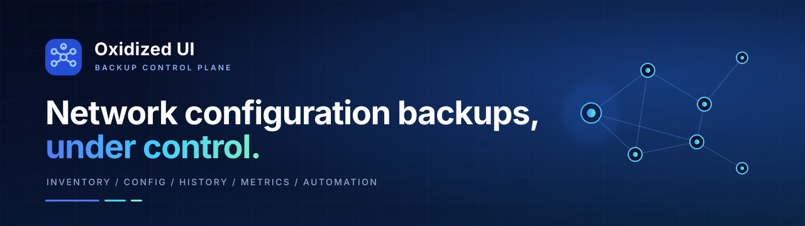
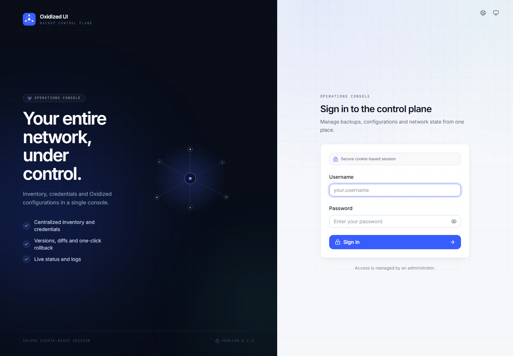
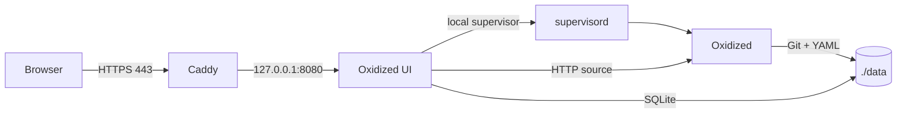

<p align="center">
  
</p>

<h1 align="center">Oxidized UI</h1>

<p align="center">
  <strong>A clean, self-hosted control plane for Oxidized network configuration backups.</strong>
</p>

<p align="center">
  <a href="https://github.com/Alexmysterio/oxidized-ui/actions/workflows/ci.yml"></a>
  <a href="https://github.com/Alexmysterio/oxidized-ui/actions/workflows/contract.yml"></a>
  
  
  
  
</p>

<p align="center">
  <a href="#quick-start"><strong>Quick start</strong></a> ·
  <a href="#what-you-get"><strong>Features</strong></a> ·
  <a href="#configuration-reference"><strong>Configuration</strong></a> ·
  <a href="#troubleshooting"><strong>Troubleshooting</strong></a> ·
  <a href="SECURITY.md"><strong>Security</strong></a>
</p>

Oxidized UI turns [Oxidized](https://github.com/ytti/oxidized) into a complete
backup workspace: inventory, encrypted credentials, configuration history,
diff and rollback, scheduling, audit, metrics, and notifications. The default
distribution runs **Oxidized, the web UI, and Caddy in one Docker container**.

It uses a private local certificate authority, so no public certificate or
external certificate service is required. It is intended for a home lab, a small
office, or a trusted internal network.

<p align="center">
  
  <br>
  <em>Login screen. The interface is available in English and Spanish.</em>
</p>

## At a glance

| 🗂️ Inventory | 🔐 Security | 📊 Operations |
|---|---|---|
| Nodes, groups, models, credentials, CSV import/export, bulk edit, saved filters, and node-to-node diff. | Argon2id passwords, TOTP, recovery codes, session revocation, IP allowlist, API tokens, OIDC, and encrypted secrets. | Backups by node or group, persistent jobs, live logs, SLA, history, audit, Prometheus, webhooks, and encrypted export. |
| **⚙️ Configuration** | **🧭 Visibility** | **🐳 Deployment** |
| YAML editor, validation, preflight, apply, health check, rollback, and scheduled maintenance windows. | Dashboard, per-node status, version history, diffs, backup timeline, and group-level success rate. | One image by default. A four-container hardened mode is available for stricter isolation. |

> **New to Docker?** Follow the [Quick start](#quick-start) step by step. Every
> command is shown explicitly. You do not need to understand the internals to get
> a working installation.

---

## Contents

- [What you get](#what-you-get)
- [How it works](#how-it-works)
- [Requirements](#requirements)
- [Quick start](#quick-start)
- [Everyday use](#everyday-use)
- [Configuration reference](#configuration-reference)
- [Persistent data and backups](#persistent-data-and-backups)
- [Updating and resetting](#updating-and-resetting)
- [Secure multi-container mode](#secure-multi-container-mode)
- [Certificates explained](#certificates-explained)
- [Notifications](#notifications)
- [Backup schedules](#backup-schedules)
- [API tokens](#api-tokens)
- [OIDC login](#oidc-login)
- [Incoming webhooks](#incoming-webhooks)
- [Metrics](#metrics)
- [Encrypted export](#encrypted-export)
- [Troubleshooting](#troubleshooting)
- [Security notes](#security-notes)
- [Development](#development)
- [Known limitations](#known-limitations)

---

## What you get

- Web inventory of Oxidized nodes.
- Per-node configuration history and side-by-side diffs.
- Credentials stored write-only and encrypted with Fernet.
- Users with `admin`, `operator`, and `viewer` roles.
- Password policy, account lockout, IP allowlist, MFA/TOTP, and revocable sessions.
- Restart/reload of Oxidized from the UI.
- Configuration editor with validation, preflight, diff, apply, health check,
  and rollback.
- Scheduled configuration apply and backup schedules by group.
- Manual and scheduled backups with a persistent, cancellable job queue.
- Backup history, success rate, and SLA by group.
- Prometheus metrics.
- Audit log with CSV export.
- Outgoing failure/stale-backup webhooks and an incoming backup webhook.
- API tokens for automation.
- Optional generic OIDC login.
- English and Spanish interface.
- One Docker image by default; a hardened four-container mode is optional.

---

## How it works

### Default: one image, one container

The container runs three processes under `supervisord`:

```text
+--------------------------------------------------------------+
| oxidized-ui container                                        |
|                                                              |
|  supervisord (root)                                          |
|    +-- Caddy          HTTPS :80/:443 -> UI :8080             |
|    +-- oxidized-ui    FastAPI + React, 127.0.0.1:8080        |
|    +-- oxidized       Oxidized engine, 127.0.0.1:8888        |
|                                                              |
|  Data: ./data/ui, ./data/config, ./data/oxidized             |
+--------------------------------------------------------------+
```



Only ports `80` and `443` are published to the host. The UI and Oxidized API
stay inside the container. There is no Docker socket and no Docker socket proxy
in this mode. The UI controls Oxidized through the local `supervisord` API, so
restarting Oxidized does not restart the whole container.

### Alternative: four-container mode

`docker-compose.secure.yml` runs Caddy, the UI, Oxidized, and a read-only Docker
socket proxy in separate containers. This provides stronger process isolation but
requires more resources and the Docker socket proxy. See
[Secure multi-container mode](#secure-multi-container-mode).

---

## Requirements

- A computer that is always on (mini PC, server, or desktop).
- Docker Engine with Docker Compose v2.
- At least 2 GB of free RAM and about 2 GB of free disk space.
- A hostname or IP address for the service.
- TCP ports `80` and `443` available on the host.
- Network access from the container to your devices (SSH/Telnet).

The default image is based on `oxidized/oxidized:0.37.0` and includes Caddy and
`supervisord`. The UI uses Python/FastAPI; the frontend is React/TypeScript.

---

## Quick start

The examples use:

```text
oxidized.example.com
```

Replace it with a name you control, such as `oxidized.home.arpa`,
`oxidized.lan`, or `backups.example.net`. For same-computer access,
`oxidized.local` also works if you add it to your hosts file.

### 1. Install Docker

Install Docker Engine or Docker environment for your platform, including the Compose
v2 plugin. Follow the official Docker installation instructions for your system.

Check that both commands work:

```bash
docker --version
docker compose version
```

Your user must have permission to run Docker. If `docker` requires elevated
privileges on your system, configure access according to your Docker installation.

### 2. Download only the compose file

You do not need to clone the repository. Create a directory and download the
single compose file:

```bash
mkdir oxidized-ui
cd oxidized-ui
curl -fsSLO https://raw.githubusercontent.com/Alexmysterio/oxidized-ui/main/compose.yaml
```

If `curl` is not available, open that URL in a browser and save the file as
`compose.yaml` in the new directory.

The image is pulled from:

```text
ghcr.io/alexmysterio/oxidized-ui:latest
```

> **One-time GitHub Packages setting:** the image is published at
> `ghcr.io/alexmysterio/oxidized-ui:latest`. If a pull is denied, open
> [Package settings](https://github.com/users/Alexmysterio/packages/container/package/oxidized-ui/settings)
> once and set visibility to **Public**. GitHub does not expose an API to change
> container package visibility automatically.

### 3. Configure the hostname

All settings can be placed in a `.env` file next to `compose.yaml`. Copy the
example:

```bash
curl -fsSLO https://raw.githubusercontent.com/Alexmysterio/oxidized-ui/main/.env.example
mv .env.example .env
```

Or edit the values directly in `compose.yaml`.

At minimum, change:

```env
UI_HOSTNAME=oxidized.example.com
```

`UI_DOMAIN` is an optional second hostname served by Caddy; use a different name
from `UI_HOSTNAME` or leave it as the example.

The name must resolve to the Docker host. Configure a DNS record, or add it to
the hosts file of the clients that will access the UI. For same-computer access,
point it to loopback; for LAN access, point it to the host's LAN address.

Verify resolution:

```bash
nslookup oxidized.example.com
```

The result must be the Docker host. If it is a public address and you are not
forwarding ports, the browser will not reach Caddy.

The secrets are optional:

- leave `SECRET_KEY`, `FERNET_KEY`, and `OXIDIZED_SOURCE_TOKEN` empty on a new
  installation; they are generated automatically and stored in
  `data/ui/.runtime-secrets`;
- set them explicitly when reusing an existing database or restoring a backup.

### 4. Start the service

```bash
docker compose up -d
```

Docker pulls the published image and starts one container. Check:

```bash
docker compose ps
docker compose logs -f oxidized-ui
```

Wait for `healthy`. Test the internal health endpoint:

```bash
docker compose exec oxidized-ui python3 -c "import urllib.request; print(urllib.request.urlopen('http://127.0.0.1:8080/api/health').read().decode())"
```

Expected:

```json
{"status":"ok","database":"ok","config_writable":true,"setup_required":true}
```

`setup_required: true` means no administrator exists yet.

Open:

```text
https://oxidized.example.com
```

Use `https://`, not `http://`. Port `8080` is not published.

### 5. Trust the local certificate

Caddy creates a private CA. Browsers warn until that CA is trusted. Traffic is
still encrypted, but importing the CA removes the warning and prevents accepting
a wrong certificate.

Export the public CA:

```bash
docker cp oxidized-ui:/data/caddy/caddy/pki/authorities/local/root.crt ./oxidized-ui-ca.crt
```

It is also available on the host at:

```text
data/ui/caddy/caddy/pki/authorities/local/root.crt
```

Install `oxidized-ui-ca.crt` as a trusted root CA in the certificate store used
by your browser or operating environment. The exact menu and command depend on
your platform. If your browser has its own certificate store, import it there as
well.

For a quick test only:

```bash
curl -k https://oxidized.example.com/api/health
```

Do not use `-k` for normal operation.

### 6. Create the first administrator

Open `https://oxidized.example.com` and complete the setup wizard: username,
password, language. The password policy is enforced. After setup,
`setup_required` becomes `false`.

Optionally, set in `.env`:

```env
BOOTSTRAP_ADMIN_USERNAME=admin
BOOTSTRAP_ADMIN_PASSWORD=change-this-password
BOOTSTRAP_ADMIN_LANGUAGE=en
```

Remove the password from `.env` after the first start. The wizard is usually
easier and safer.

### 7. Add your first device

1. Open **Nodes -> Add node**.
2. Fill in:
   - **Name:** a unique name, e.g. `core-switch`.
   - **Address:** device IP or DNS name.
   - **Model:** Oxidized model, e.g. `ios`, `junos`, `routeros`.
   - **Group:** optional; groups can share credentials.
   - **Input:** usually `ssh`.
   - **Port:** usually `22`, or the device's SSH port.
   - **Username/password:** credentials Oxidized will use.
3. Save.
4. Open the node and select **Test connection** (TCP, SSH, authentication).
5. If the host key is unknown, verify the fingerprint and select **Trust host
   key**.
6. Select **Backup now**.

The device must be reachable from the container, not only from your desktop.

---

## Everyday use

- **Dashboard:** Oxidized status, node counts, recent activity, SLA by group,
  active jobs, and onboarding hints.
- **Nodes:** search, filters, saved filters, bulk backup/group/field/delete, CSV
  import/export, connection test, host-key trust, versions, diff, and history.
- **Configuration:** validate YAML, preflight, diff, apply, health check, and
  rollback. Scheduled apply supports maintenance windows.
- **Logs and jobs:** live Oxidized log and persistent/cancellable jobs. Queued
  jobs resume after restart; running jobs are marked interrupted.
- **Audit:** filter and export CSV; retention is separate from backup history.
- **Users and profile:** roles, sessions, password, MFA, language, theme, and API
  tokens.

---

## Configuration reference

All values go in `.env`; never commit it.

### Required

| Variable | Purpose |
|---|---|
| `SECRET_KEY` | Signs session/CSRF material. |
| `FERNET_KEY` | Encrypts stored credentials; keep it safe. |
| `OXIDIZED_SOURCE_TOKEN` | Shared token for the internal node source. |
| `UI_HOSTNAME` | Primary hostname or IP; must match the certificate. |

### Networking and UI

| Variable | Default | Purpose |
|---|---|---|
| `UI_DOMAIN` | `oxidized.local` | Optional second hostname served by Caddy. |
| `UI_HTTP_PORT` | `80` | Host HTTP port, redirects to HTTPS. |
| `UI_HTTPS_PORT` | `443` | Host HTTPS port. |
| `TZ` | `UTC` | IANA timezone. |
| `DEFAULT_LANGUAGE` | `es` | Initial language. |
| `SESSION_COOKIE_SECURE` | `true` | Keep true with HTTPS. |
| `TRUST_PROXY_HEADERS` | `true` | Trust Caddy forwarded headers. |
| `TRUSTED_ORIGINS` | derived | Comma-separated allowed origins. |

### First-run administrator

| Variable | Purpose |
|---|---|
| `BOOTSTRAP_ADMIN_USERNAME` | Optional first admin. |
| `BOOTSTRAP_ADMIN_PASSWORD` | Optional first password; remove after start. |
| `BOOTSTRAP_ADMIN_LANGUAGE` | `es` or `en`. |

### Metrics and webhooks

| Variable | Purpose |
|---|---|
| `METRICS_TOKEN` | Optional bearer token for `/api/metrics`. |
| `INBOUND_WEBHOOK_TOKEN` | Optional token for `POST /api/hooks/backup`. |

### OIDC

| Variable | Purpose |
|---|---|
| `OIDC_ENABLED` | `true` shows the OIDC button. |
| `OIDC_ISSUER` | Issuer URL with `/.well-known/openid-configuration`. |
| `OIDC_CLIENT_ID` | Client ID. |
| `OIDC_CLIENT_SECRET` | Client secret. |
| `OIDC_REDIRECT_URI` | Exactly `https://<host>/api/auth/oidc/callback`. |
| `OIDC_SCOPES` | Default `openid profile email`. |
| `OIDC_DEFAULT_ROLE` | `viewer`, `operator`, or `admin`. |
| `OIDC_AUTO_CREATE` | Create unknown users automatically. |

### History

```env
CONFIG_BACKUP_KEEP=0
```

`0` means keep all YAML backups. In the UI, set **Activity retention (days)** to
`0` to keep all backup runs. Git history is never rewritten or pruned.

---

## Persistent data and backups

The default compose uses these host directories:

| Host path | Container path | Contents |
|---|---|---|
| `./data/ui` | `/data` | SQLite, sessions, audit, Caddy CA/certificates |
| `./data/config` | `/oxidized-config` | Oxidized config, `known_hosts`, `.ui-backups`, crashes |
| `./data/oxidized` | `/var/lib/oxidized` | Git repository with device configurations |

They survive `docker compose down`, recreation, and upgrades. `data/` is excluded
from Git.

### Backup

Stop the container so SQLite has no pending writes:

```bash
docker compose stop oxidized-ui
tar -czf oxidized-ui-backup-$(date +%F).tar.gz data .env
docker compose start oxidized-ui
```

Store `.env` and the backup securely: they contain the Fernet key and encrypted
credentials.

### Restore

Stop the container, replace `data/` and `.env` with the backup, then:

```bash
docker compose up -d
```

Use the same `FERNET_KEY` that was used when the backup was created.

### Encrypted export

Administrators can use **System settings -> Export encrypted** to download an
AES-256-GCM `.oxui` file protected by a passphrase. It contains SQLite, the
Oxidized configuration, `known_hosts`, YAML backups, the Fernet key, and
metadata. The passphrase is not stored.

Restore offline:

```bash
docker compose stop oxidized-ui
python scripts/restore_encrypted_export.py backup.oxui --yes
# Put the printed FERNET_KEY into .env
docker compose start oxidized-ui
```

Without `--yes`, the script only validates and lists the archive contents.
There is intentionally no live HTTP import.

---

## Updating and resetting

### Update

```bash
docker compose pull
docker compose up -d
```

Data stays in `./data`; database migrations run automatically. Back up first.

### Reset everything (destructive)

This removes users, nodes, history, Git data, configuration, and the CA:

```bash
docker compose down
rm -rf data
docker compose up -d
```

After a reset, a new CA is generated and must be trusted again.

---

## Secure multi-container mode

If you prefer process isolation:

```bash
cp .env.secure.example .env
# edit .env
docker compose -f docker-compose.secure.yml up -d --build
```

Do not run both modes at once; they use the same container names and host ports.

In secure mode:

- UI, Oxidized, Caddy, and the Docker socket proxy are separate containers.
- The Docker socket is mounted only in the proxy, read-only.
- Caddy is the only service publishing ports.
- The UI restarts Oxidized through the proxy.
- Named volumes replace `./data` bind mounts.

The CA path in secure mode is:

```text
oxidized-ui-caddy:/data/caddy/pki/authorities/local/root.crt
```

See `docker-compose.secure.yml` and `.env.secure.example`.

---

## Certificates explained

Caddy creates a private root CA, a server certificate for `UI_HOSTNAME` and
`UI_DOMAIN` signed by that CA, and renews the server certificate automatically.
Clients trust the root CA once.

If the CA is not imported, the browser warns, but TLS still encrypts traffic. On
a shared or production network, import the CA.

The certificate is valid only for the configured names. A different hostname or
IP will not match. Do not copy the CA private key; only export `root.crt`. The
private key remains in `data/ui/caddy`.

Deleting `data/` creates a new CA; every client must trust it again.

## Notifications

Configure a webhook URL in **System settings -> Notifications**. The UI sends
job-failure, test, and stale-backup notifications. The webhook is an HTTP POST
with JSON. Use HTTPS and a secret URL where possible.

---

## Backup schedules

Open **Status and logs -> Backup schedules**:

- leave the group empty for all nodes;
- choose an interval in minutes;
- create the schedule.

The poller runs the schedule and avoids starting a second global backup while one
is queued or running.

---

## API tokens

In **Profile -> API tokens**, choose a name, role, and expiry. The token is shown
once. Use it as:

```bash
curl -H "Authorization: Bearer oxui_..." https://oxidized.example.com/api/nodes
```

Tokens are stored hashed; the role cannot exceed the user's role. Revoke at any
time.

---

## OIDC login

Set the `OIDC_*` variables and restart. A **Sign in with OIDC** button appears.
Create this redirect URI in your provider:

```text
https://oxidized.example.com/api/auth/oidc/callback
```

The flow uses authorization code + PKCE and the `userinfo` endpoint. New users are
created as `oidc_<hash-of-subject>` with `OIDC_DEFAULT_ROLE`; they do not use local
MFA. OIDC state is in memory, suitable for the single-worker deployment. Test
with your provider before relying on it.

---

## Incoming webhooks

Set `INBOUND_WEBHOOK_TOKEN`, restart, then:

```bash
curl -X POST https://oxidized.example.com/api/hooks/backup \
  -H "X-Webhook-Token: $INBOUND_WEBHOOK_TOKEN"
```

Responses: `202` accepted; `409` global backup already active; `403` wrong token;
`404` webhook not configured. No cookies or CSRF; the token is the auth.

---

## Metrics

Set `METRICS_TOKEN` to require a bearer token:

```bash
curl -H "Authorization: Bearer $METRICS_TOKEN" https://oxidized.example.com/api/metrics
```

Prometheus text format includes node status, last successful backup time, 24-hour
backup counts/ratio, job counts, and stale-node count.

---

## Troubleshooting

### Browser cannot connect

1. Container healthy?

```bash
docker compose ps
```

2. Hostname resolves to the Docker host?

```bash
nslookup oxidized.example.com
```

3. Internal health okay?

```bash
docker compose exec oxidized-ui python3 -c "import urllib.request; print(urllib.request.urlopen('http://127.0.0.1:8080/api/health').read().decode())"
```

4. Caddy answers?

```bash
curl -k https://oxidized.example.com/api/health
```

If loopback works but LAN IP does not, use the Docker environment port proxy above.

### Certificate warning

- Use `https://`, not `http://`.
- The hostname must match `UI_HOSTNAME` or `UI_DOMAIN`.
- Import the CA into the certificate store used by the client.
- After deleting `data/`, re-import the new CA.

### `setup_required` remains true

No user exists. Complete the setup wizard. Remove bootstrap credentials after the
first start.

### Oxidized does not start

With no nodes, Oxidized waits for the internal source. Add a node and check:

```bash
docker compose logs oxidized-ui
docker exec oxidized-ui supervisorctl -s http://127.0.0.1:9001 status
```

All three programs should be `RUNNING`: `ui`, `oxidized`, `caddy`.

### SSH authentication fails

- Test credentials from the Docker host.
- Verify IP, SSH port, and host key.
- Use **Test connection** and read the error code.
- Ensure the device accepts SSH from the Docker host.

### Permission denied on `data/`

The UI and Oxidized use UID/GID `30000`. The host directories must be writable
by that UID/GID. If they are not, correct ownership using your platform's file
management tools. Do not use world-writable permissions.

### Forgot the admin password

There is no email reset. Use another admin account or restore a backup. Otherwise
reset the data (destructive) and set up again.

### Logs

```bash
docker compose logs -f oxidized-ui
docker exec oxidized-ui supervisorctl -s http://127.0.0.1:9001 status
docker exec oxidized-ui tail -n 100 /var/log/supervisor/oxidized.log
```

### Full reset

See [Updating and resetting](#updating-and-resetting).

---

## Security

See [SECURITY.md](SECURITY.md) for the reporting process and the secure
deployment checklist, and [docs/SECURITY-AUDIT.md](docs/SECURITY-AUDIT.md) for
the latest review.

## Security notes

- Keep `.env` out of Git and backups in a secure place.
- Losing `FERNET_KEY` means stored credentials cannot be decrypted.
- Use a unique admin password and enable MFA.
- Keep `SESSION_COOKIE_SECURE=true`; access only over HTTPS.
- Restrict access to a trusted network or VPN. Do not expose directly to the
  public Internet without a reverse proxy, firewall, and additional controls.
- API tokens are bearer credentials: treat them like passwords.
- OIDC users bypass local MFA; enforce MFA at the identity provider.
- The single-container mode runs root supervisor and Caddy beside the UI. Use the
  four-container mode for stronger process isolation.
- The single-container mode does not mount the Docker socket.
- Back up `data/` and `.env` before upgrades.

---

## Development

### Backend

```bash
cd backend
uv sync --extra dev
uv run pytest -q
uv run ruff check app tests
uv run uvicorn app.main:app --reload --port 8000
```

### Frontend

```bash
cd frontend
pnpm install
pnpm dev
```

Vite proxies `/api` to `http://127.0.0.1:8000`.

### Tests

```bash
cd frontend
pnpm test
pnpm typecheck
node scripts/check-i18n.mjs
pnpm build
```

Playwright:

```bash
pnpm exec playwright install chromium
pnpm build
pnpm test:e2e
```

### CI

GitHub Actions runs backend tests/Ruff, frontend tests/typecheck/i18n/build,
Playwright login smoke, Docker build, Trivy, SBOM, and a real contract test
against a disposable Oxidized container. See `.github/workflows/ci.yml` and
`.github/workflows/contract.yml`.

### Repository layout

```text
backend/                  FastAPI application, migrations, tests
frontend/                 React application, tests, e2e
docker/                   Caddy and single-container supervisor files
scripts/                  Restore/helper scripts
tests/contract/           Disposable Oxidized fixture for CI
compose.yaml              Standalone image deployment
docker-compose.secure.yml Four-container deployment
Dockerfile                Single-image build
Dockerfile.secure         Multi-container UI image
docs/                     Technical documentation
```

More documentation:

- [Security policy](SECURITY.md)
- [Security audit](docs/SECURITY-AUDIT.md)

---

## Known limitations

- One Uvicorn worker only; SQLite, in-process locks, and the poller are not
  designed for horizontal scaling.
- Queued jobs survive restart; running jobs are marked interrupted and must be
  started again.
- Scheduled configuration apply is the maintenance-window mechanism; there is no
  separate weekly calendar UI.
- `gitcrypt` requires a derived image with `git-crypt`.
- OIDC has not been validated against every provider; test yours.
- Device backups depend on reachability and correct credentials.
- Docker environment may expose ports only on loopback; see the port-proxy section.
