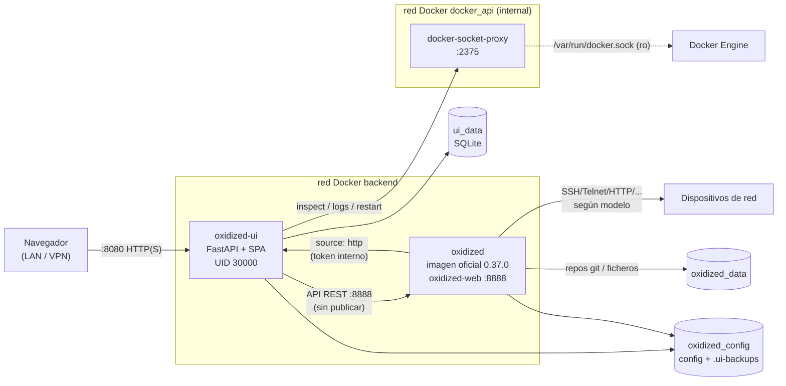
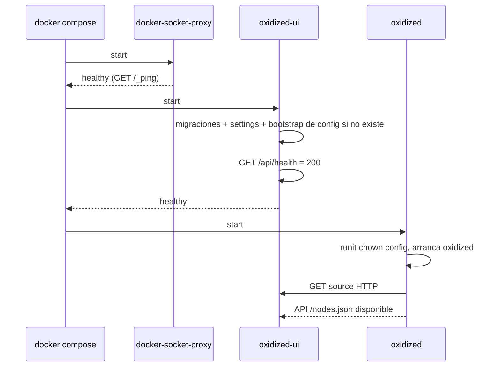
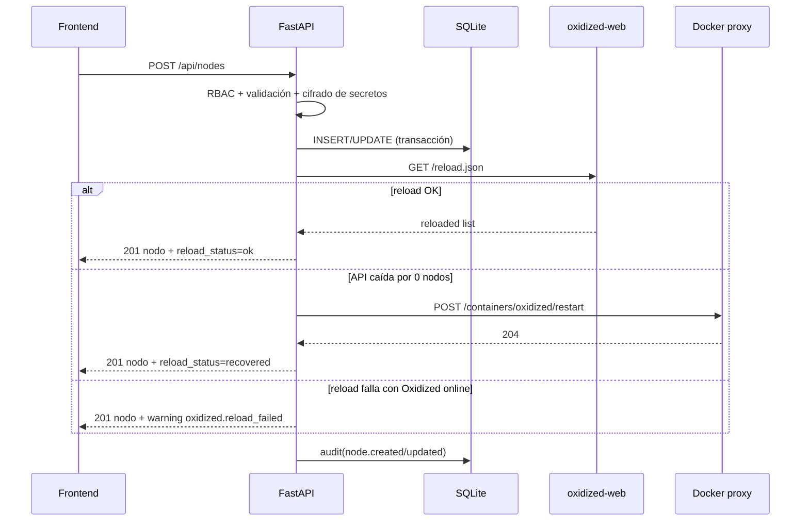
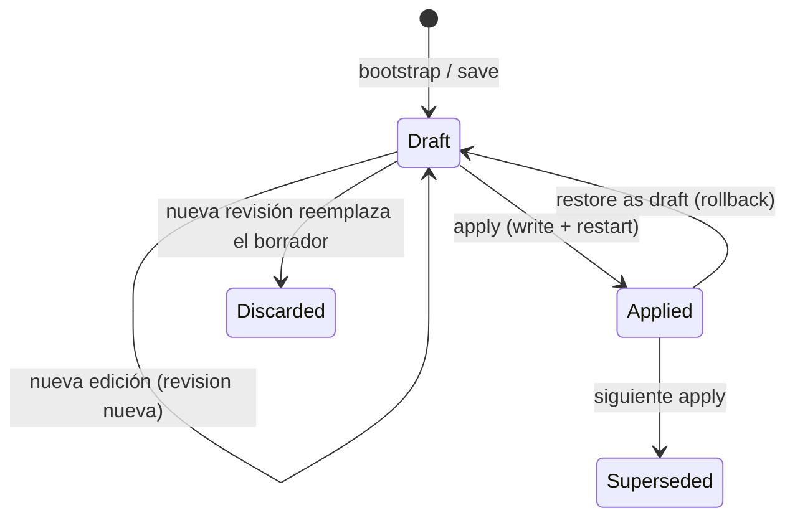

# Oxidized UI — Arquitectura (Fase 1)

Estado: diseño aprobado para implementación. Este documento es la referencia de
las fases 2–4: backend, frontend, tests y README.

## 1. Objetivo y alcance

Oxidized UI es un panel de administración para un despliegue de Oxidized:

- Un único contenedor de UI (FastAPI + SPA compilada).
- Un contenedor Oxidized con la imagen oficial.
- Un contenedor `tecnativa/docker-socket-proxy` para inspeccionar, leer logs y
  reiniciar **solo** el contenedor de Oxidized.
- SQLite como base de datos local de la UI.
- Volumen compartido con el directorio de configuración de Oxidized.
- Ningún acceso del usuario al socket de Docker ni a la API de oxidized-web.
- Interfaz bilingüe (es/en, ampliable) y roles admin/operator/viewer aplicados en
  el backend.

Decisiones de integración, endpoints verificados y limitaciones:
[OXIDIZED-INTEGRATION.md](OXIDIZED-INTEGRATION.md). Modelo de datos:
[DATA-MODEL.md](DATA-MODEL.md). Cobertura de parámetros:
[CONFIGURATION-COVERAGE.md](CONFIGURATION-COVERAGE.md). Contrato de API:
[API-CONTRACT.md](API-CONTRACT.md).

## 2. Vista de despliegue



Características de la topología:

- Solo se publica el puerto de la UI. Por defecto se enlaza a `127.0.0.1`;
  para acceso remoto se debe poner detrás de TLS y cambiar
  `UI_BIND_ADDRESS=0.0.0.0` o usar un reverse proxy.
- `oxidized-web` no se publica y no tiene autenticación. Solo la UI puede
  alcanzarlo en `backend`.
- El socket de Docker se monta **solo** en `docker-socket-proxy`, en modo
  read-only. La red `docker_api` es `internal: true` y no la comparte Oxidized.
- La red `backend` no es `internal` porque Oxidized necesita alcanzar los
  dispositivos, servidores git, Slack, etc. La UI está en ambas redes.
- Los tres servicios tienen healthcheck. Solo la UI publica puerto.
- La UI y Oxidized comparten UID/GID 30000 para el volumen de configuración;
  la UI sigue siendo un proceso no root. El supervisor de la imagen oficial de
  Oxidized sí arranca como root para hacer `chown` y bajar privilegios, algo
  inherente a esa imagen.
- La imagen de la UI debe crear `/data` y `/oxidized-config` con owner 30000 en
  el Dockerfile. Docker inicializa los named volumes copiando el owner del
  directorio de la imagen; si el path no existe, el volumen nace root y la UI no
  podría escribir. Si se usan bind mounts, el propietario debe ser 30000:30000.

### Arranque



- La UI arranca sin necesitar a Oxidized. Su healthcheck no depende de que
  Oxidized esté sano; si dependiera, el orden sería circular.
- En el primer arranque, con cero nodos, Oxidized no puede arrancar porque
  `Core` lanza `NoNodesFound`. Es un estado esperado: la UI muestra Oxidized
  offline y, al crear el primer nodo, hace una recuperación automática del
  contenedor.
- El fichero de configuración se genera en el primer arranque de la UI. Por eso
  Oxidized espera a que la UI esté healthy.

## 3. Componentes

### 3.1 Backend (FastAPI)

Responsabilidades:

- Autenticación, sesiones, CSRF, rate limiting, RBAC y auditoría.
- CRUD de nodos, grupos, usuarios y ajustes.
- Modelo estructurado de configuración de Oxidized, validación, generación YAML,
  versiones, diff, aplicación atómica y rollback.
- Cliente HTTP de oxidized-web con timeouts, límites de tamaño y errores
  normalizados.
- Cliente de Docker Engine a través del proxy (solo inspect/logs/restart).
- SSE de logs y descarga de logs.
- Poller periódico de estado (`/nodes.json`) y persistencia de observaciones.
- Endpoint interno de source HTTP protegido por token.
- Serialización de errores con códigos estables, nunca frases localizadas.

No hace ninguna llamada saliente a dispositivos de red. Esas conexiones son
responsabilidad exclusiva de Oxidized.

Se ejecuta con **un solo worker de Uvicorn**. SQLite y el fichero de
configuración no están pensados para escrituras concurrentes multi-proceso; la
simplicidad y la consistencia son más importantes que el escalado horizontal.
El estado compartido en memoria (locks, caché de estado, streams) es seguro con
un worker. Para más escala habría que migrar a PostgreSQL y locks distribuidos,
fuera del alcance.

### 3.2 Frontend (React + Vite)

- SPA servida por FastAPI como estáticos, salvo `/api/*`.
- React Router para rutas; TanStack Query para estado servidor; React Hook Form +
  Zod para formularios; react-i18next para textos.
- CodeMirror 6 (`@codemirror/lang-yaml`, `@codemirror/merge`) para YAML, configs
  y diff. Se elige CodeMirror frente a Monaco por peso, porque no se necesitan
  workers de lenguaje y encaja mejor con el CSP.
- Recharts para el gráfico de actividad; lucide-react para iconografía.
- Tailwind CSS + shadcn/ui (componentes copiados al repo). No se importan
  componentes desde un CDN.
- Tipografía Inter self-hosted (`@fontsource-variable/inter`).
- Tema claro/oscuro/sistema con clase `dark`, `prefers-color-scheme` como
  defecto.
- i18n: ficheros en `frontend/public/locales/*.json`; el backend descubre los
  idiomas disponibles leyendo esos ficheros del build. Añadir un idioma solo
  requiere añadir el JSON y reconstruir.

### 3.3 Oxidized

- Imagen oficial fijada.
- Configuración generada y versionada por la UI.
- Source HTTP contra la UI; sin fichero `router.db`.
- `next_adds_job: true` por defecto para que los backups forzados se ejecuten
  cuanto antes.
- Output git por defecto, para que las versiones y diffs estén disponibles.
  La UI avisa si se selecciona un output que no soporta versiones (`file`,
  `http`).
- `oxidized-web` habilitado en `0.0.0.0:8888`, sin publicar y sin auth propia.

### 3.4 docker-socket-proxy

- Permisos mínimos por secciones: `CONTAINERS=1`, `POST=1`,
  `ALLOW_RESTARTS=1`, `PING=1`; todo lo demás deshabilitado explícitamente.
- Solo accesible desde `docker_api`, compartida únicamente con la UI.
- La UI solo llama a inspect, logs y restart del contenedor configurado.
- Riesgo residual documentado: el proxy no permite limitar por nombre de
  contenedor mediante variables; una UI completamente comprometida podría
  reiniciar otros contenedores. No puede ejecutar comandos ni montar volúmenes
  (`EXEC=0`, etc.). Ver [OXIDIZED-INTEGRATION.md](OXIDIZED-INTEGRATION.md).

## 4. Flujos principales

### 4.1 Autenticación

1. `POST /api/auth/login` con usuario y contraseña.
2. Rate limit por IP+usuario e IP global, ventana deslizante en SQLite.
3. Verificación Argon2id; si el usuario no existe se verifica igualmente un hash
   dummy para no filtrar por timing.
4. Se crea una sesión nueva (fijación de sesión evitada) y se emite una cookie
   `HttpOnly; SameSite=Lax; Path=/; Secure` según configuración.
5. La base de datos guarda solo el hash SHA-256 del token de sesión.
6. El CSRF token se deriva por HMAC del token de sesión con `SECRET_KEY`; se
   entrega en `GET /api/auth/session` y el frontend lo envía en la cabecera
   `X-CSRF-Token` de cada método no seguro. No se guarda en claro ni en cookie.
7. Todos los métodos no seguros validan además `Origin`/`Referer` contra el
   origen de la petición (o `TRUSTED_ORIGINS`).
8. Logout revoca la sesión. Desactivar un usuario, cambiar su rol o su contraseña
   invalida las sesiones que corresponda.

El login y el setup no tienen sesión previa: se protegen con validación de
origen, `SameSite`, `Content-Type: application/json` y rate limiting. No se
aceptan formularios cross-site.

### 4.2 Primer arranque

- Si no hay usuarios y no se han definido variables `BOOTSTRAP_ADMIN_*`, la API
  pública solo permite `/api/meta`, `/api/setup` y `/api/health`.
- El asistente crea el primer admin en una transacción; si dos peticiones
  compiten, solo una puede ganar (constraint/condición de tabla vacía).
- Si hay bootstrap admin por entorno, se crea al arrancar y el asistente no se
  muestra. La contraseña de entorno no se guarda en claro ni se escribe en logs;
  se recomienda cambiarla tras el primer acceso.
- El idioma del primer admin es el del selector del asistente o, en su defecto,
  el del navegador; si no es es/en, `DEFAULT_LANGUAGE`. El backend solo valida el
  código contra los idiomas disponibles.
- La UI crea una revisión de configuración inicial (source HTTP + oxidized-web +
  output git) y la escribe atómicamente si no existe un fichero `config`.
- Si el volumen ya contiene un `config` (instalación previa), la UI **no lo
  sobrescribe**. Captura una instantánea, lo muestra como configuración externa
  y ofrece al admin importarlo/adoptarlo. Hasta que se adopte, los nodos de la
  UI no se consideran integrados y la UI muestra un aviso explícito. Esto evita
  destruir una configuración manual en el primer arranque.

### 4.3 CRUD de nodos y recarga



- Los nodos son la fuente de verdad en SQLite. Oxidized los lee por source HTTP.
- No hay reinicio en cambios de nodos.
- Las operaciones en lote se ejecutan con una transacción y una única recarga al
  final, no una por nodo.
- Los nombres de nodo son únicos globalmente y seguros para rutas (sin `/`,
  `\`, `..`, caracteres de control ni `.json` final ambiguo). Los grupos no
  permiten `/` ni `..` por seguridad de rutas de repositorio y de la API.
- Borrar un nodo no borra sus backups históricos; se documenta en la UI.

### 4.4 Configuración: guardar, previsualizar, aplicar



- **Guardar** crea una revisión `draft` cifrada en SQLite. No toca el fichero ni
  Oxidized. Devuelve diff frente a la revisión aplicada.
- **Guardar y aplicar** es una acción exclusiva de admin. Crea un job asíncrono
  que valida, escribe de forma atómica y reinicia Oxidized; la UI sigue el job y
  no bloquea la petición HTTP durante el reinicio.
- **Restaurar una versión** crea un nuevo borrador a partir de la revisión
  elegida; el usuario revisa el diff y aplica. El historial es inmutable: nunca
  se reescribe una revisión antigua.
- Solo hay un borrador activo. Las colisiones se resuelven con
  `expected_revision_id` (optimistic concurrency) y devolviendo
  `config.stale_draft`.
- El editor de formulario y el editor YAML comparten el mismo modelo
  estructurado. Las claves desconocidas se preservan en `extra`; el editor YAML
  completo sirve para parámetros no modelados.
- La vista previa de diff se calcula contra la revisión aplicada y se muestra en
  CodeMirror Merge.
- El YAML generado se ordena de forma determinista y usa una representación
  compatible con Oxidized para expresiones regulares Ruby
  (`!ruby/regexp /.../`). No se ejecuta Ruby ni se evalúa el contenido.
- Antes de escribir se hace copia en SQLite y en `.ui-backups/`; después,
  escritura en temporal + `fsync` + `os.replace` + `fsync` del directorio.
- Si el reinicio falla, el fichero ya está aplicado en disco. La UI lo informa
  con un error compuesto y permite reintentar el reinicio. No se revierte el
  fichero de forma silenciosa.
- Si el fichero del volumen diverge del checksum de la revisión activa, se marca
  drift. El siguiente apply guarda una instantánea del contenido externo antes
  de sobrescribir y lo audita.
- Rollback de seguridad opcional: si Oxidized tenía nodos y no vuelve a estar
  disponible tras el reinicio, la UI puede restaurar la configuración anterior y
  reiniciar otra vez. Se implementará como parte del job de aplicación con
  timeout y quedará auditado; no se aplica en el primer arranque con 0 nodos.

### 4.5 Backups, versiones y diff

- Backup individual: llama a `/node/next/<name>.json` y devuelve un job de UI.
- Backup masivo: itera todos los nodos con concurrencia limitada y registra
  progreso, éxitos y fallos por nodo.
- Versiones: `/node/version` para el historial y `/node/version/view` para el
  contenido. El backend valida que el output sea compatible (git/gitcrypt).
- Diff: el backend descarga las dos versiones y calcula:
  - un `unified_diff` para la vista unificada;
  - filas lado a lado (old/new) con marcas de añadido/eliminado/cambiado para la
    vista principal.
  El endpoint HTML de diff de oxidized-web no se usa.
- Para output `file`/`http` no hay historial: la UI desactiva versiones/diffs y
  muestra un estado vacío explicativo.
- Los contenidos y diffs se devuelven como texto; React no interpreta HTML. El
  tamaño máximo por config se limita en el backend.
- La descarga usa `Content-Disposition` y un nombre seguro; no se aceptan rutas
  del usuario.

### 4.6 Estado, logs y jobs

- Un poller en segundo plano consulta `/nodes.json` cada 30 s (configurable) y
  actualiza `node_status_cache` y `backup_runs`. El dashboard puede forzar una
  actualización puntual.
- Estados:
  - `ok`: último estado observado `success`.
  - `failed`: último estado observado distinto de `success` y no nulo.
  - `pending`: job de UI en cola/ejecutándose sin backup completado.
  - `never`: sin observación de backup.
- La actividad se calcula con `backup_runs` de los últimos N días. Es una
  observación periódica, no un contador oficial de jobs de Oxidized.
- Logs:
  - `GET /api/logs` devuelve un snapshot filtrado.
  - `GET /api/logs/stream` es SSE, hace `follow` contra Docker Engine y filtra
    por nivel/búsqueda en servidor sin alterar el texto.
  - `GET /api/logs/download` devuelve un fichero de texto.
  - En error de Docker, se devuelve `docker.logs_unavailable`; nunca se inventan
    líneas.
- La pantalla de jobs muestra los jobs de la UI y el estado de nodos observado.
  No se presenta como una cola de Oxidized porque no existe endpoint oficial.

### 4.7 Logs en vivo: diseño técnico

- El cliente httpx abre un stream con
  `GET {proxy}/containers/{name}/logs?stdout=1&stderr=1&follow=1&timestamps=1&tail=500`.
- El contenedor de Oxidized no tiene TTY, así que el cuerpo es el formato
  multiplexado de Docker (cabecera de 8 bytes por frame). Se demultiplexa y se
  convierte cada frame en un evento SSE:
  `{seq, ts, stream, level, line}`.
- El nivel se infiere del prefijo de SemanticLogger (`T/D/I/W/E/F` o palabras
  completas) y de stderr. La línea original permanece intacta.
- Al desconectarse el navegador se cancela la tarea y se cierra el stream
  upstream. Hay un límite de buffer y un timeout de inactividad.
- El endpoint requiere rol admin u operator (viewer no tiene acceso a logs).
- La descarga de logs no usa SSE y tiene un límite de líneas.

## 5. Seguridad

### 5.1 Controles backend

| Riesgo | Control |
|---|---|
| Robo de contraseñas | Argon2id, rate limit, errores genéricos, sesión rotada. |
| Session fixation / XSS de sesión | Cookie `HttpOnly`, `SameSite=Lax`, `Secure` opcional, token opaco y hash en BD. |
| CSRF | Validación de `Origin`/`Referer` + token por sesión derivado con HMAC en cabecera. |
| Fuerza bruta | Ventana deslizante en SQLite por IP+usuario y por IP; 429 con `Retry-After`. |
| Escalada de privilegios | Dependencias RBAC en cada endpoint, no solo en la UI. |
| Secretos en reposo | Fernet para credenciales de nodo, vars y revisiones de config. Clave fuera de la BD. |
| Secretos en tránsito | La API nunca devuelve contraseña/enable de nodos; logs/auditoría sin secretos. HTTPS recomendado. |
| Path traversal / escritura arbitraria | Rutas fijas de configuración; no se aceptan paths de escritura; nombres de nodo/grupo validados. |
| Shell injection | No se usa `subprocess`/shell; los hooks solo se escriben como YAML. |
| SSRF | El backend solo llama a endpoints internos configurados; URLs de sistema validadas. |
| XSS | React escapa; no se usa HTML de oxidized-web; CSP estricta; `dangerouslySetInnerHTML` prohibido. |
| Clickjacking | `frame-ancestors 'none'` + `X-Frame-Options: DENY`. |
| Fuerza bruta / payloads | Límite de tamaño de body, límite de filas CSV, longitud de YAML y listas. |
| Acceso a Docker | Solo el proxy; UI sin socket; red interna; mínimo de secciones. |
| Contenedor comprometido | UI no root, `cap_drop: ALL`, `no-new-privileges`, filesystem read-only + tmpfs, solo /data y config escribibles. |

- Las contraseñas de nodo y `enable` se cifran por campo con Fernet. Las vars del
  nodo se guardan cifradas en bloque. La respuesta de la API solo incluye
  `has_password` / `has_enable`.
- Las credenciales globales de configuración (por ejemplo, password de grupo,
  token de Slack) viven dentro del JSON cifrado de la revisión. El editor de
  configuración es solo admin y puede verlas al editar el YAML; no aparecen en
  logs ni auditoría. La pantalla de grupos para operator usa endpoints con
  secretos enmascarados y semántica de reemplazo.
- La respuesta de `/nodes.json` de oxidized-web incluye `vars`, que puede
  contener credenciales. El backend extrae solo estado y descarta `vars`; nunca
  las persiste ni las devuelve. La UI no usa `/node/show` para credenciales.
- La auditoría guarda códigos y parámetros no sensibles. Nunca cuerpos de
  petición, contraseñas, tokens, valores de variables ni YAML completo.
- Los errores no incluyen trazas ni detalles internos en producción; se registra
  un ID de correlación en logs del servidor.

### 5.2 Cabeceras y sesión

- `Content-Security-Policy: default-src 'self'; script-src 'self'; style-src 'self' 'unsafe-inline'; img-src 'self' data:; font-src 'self'; connect-src 'self'; frame-ancestors 'none'; base-uri 'self'; form-action 'self'`.
- `X-Content-Type-Options: nosniff`, `Referrer-Policy: no-referrer`,
  `Permissions-Policy` restrictiva, `X-Frame-Options: DENY`.
- HSTS solo cuando la cookie es `Secure` y la petición llega por HTTPS.
- No se habilita CORS: la SPA es same-origin. En desarrollo, Vite proxy.
- El servidor no confía en `X-Forwarded-For` salvo `TRUST_PROXY_HEADERS=true`.

### 5.3 Permisos

| Capacidad | admin | operator | viewer |
|---|---:|---:|---:|
| Dashboard / estado / nodos (lectura) | ✅ | ✅ | ✅ |
| Ver username de nodo, vars, IP | ✅ | ✅ | ❌ (sin credenciales) |
| Crear/editar/borrar nodos, importar/exportar | ✅ | ✅ | ❌ |
| Backup individual/masivo, reload | ✅ | ✅ | ❌ |
| Versiones, contenido, diff, descarga | ✅ | ✅ | ✅ (solo lectura) |
| Búsqueda en configs | ✅ | ✅ | ✅ |
| Logs y jobs | ✅ | ✅ | ❌ |
| Grupos: ver / guardar borrador | ✅ | ✅ | ❌ |
| Aplicar config / reiniciar Oxidized | ✅ | ❌ | ❌ |
| Configuración global, YAML avanzado | ✅ | ❌ | ❌ |
| Usuarios, sistema, auditoría | ✅ | ❌ | ❌ |
| Ajustes propios (idioma, tema, password) | ✅ | ✅ | ✅ |

La UI oculta acciones no permitidas, pero **el backend es la autoridad**. Todos
los endpoints tienen una dependencia de rol y los tests cubren 403/401.

## 6. Modelo de configuración

### 6.1 Fuente de verdad

- **Nodos** y **usuarios** viven en SQLite.
- La **configuración de Oxidized** vive en SQLite como un JSON estructurado por
  secciones, con un modelo Pydantic que:
  - valida tipos, rangos y enums;
  - conserva claves desconocidas (`extra="allow"`) para el editor YAML;
  - representa mapas con claves regex como listas de entradas
    `{match, is_regex, target}` y las serializa con `!ruby/regexp`;
  - no contiene los bloques gestionados de integración, que se inyectan al
    renderizar.
- **Grupos** forman parte de ese JSON (`groups`) y se editan en su pantalla
  dedicada. No hay una tabla duplicada de grupos. Los nodos guardan
  `group_name`, validado contra los grupos de la configuración **aplicada**.
- La pantalla de grupos de un operator crea/edita un borrador de configuración;
  un admin debe aplicarlo porque las credenciales de grupo afectan al YAML de
  Oxidized y requieren reinicio. Es una consecuencia directa de la matriz de
  roles y se documenta en la UI como «pendiente de aplicar».

### 6.2 Revisiones

Cada revisión contiene:

- JSON canónico cifrado.
- YAML efectivo cifrado (con los bloques gestionados).
- SHA-256 del JSON y del YAML.
- Autor, fecha, estado (`draft`, `applied`, `superseded`, `discarded`),
  procedencia (`form`, `yaml`, `groups`, `rollback`, `bootstrap`,
  `external_import`) y revisión padre.
- Metadatos de aplicación (quién/cuándo, hash escrito, copia de seguridad).

El estado activo (`applied_revision_id`, hash del fichero, drift) vive en
`system_state`. La historia es append-only. Rollback = nueva revisión.

### 6.3 Cobertura y editor YAML

El formulario está generado por un catálogo de metadatos (tipo, default, rango,
opciones, nivel de visibilidad y claves i18n). Todos los parámetros documentados
de Oxidized tienen una representación estructurada. Lo que no se modela en el
formulario se conserva y se edita en el editor YAML completo; las claves
desconocidas nunca se descartan al pasar por el formulario.

Las claves gestionadas (source interno y `extensions.oxidized-web`) no son
editables en el YAML. El editor muestra su presencia y el backend rechaza
cambios. Detalle y justificación en
[CONFIGURATION-COVERAGE.md](CONFIGURATION-COVERAGE.md) y
[OXIDIZED-INTEGRATION.md](OXIDIZED-INTEGRATION.md).

## 7. Internacionalización

- `react-i18next`; ficheros `frontend/public/locales/es.json` y `en.json`.
- Las pantallas de login y setup muestran un selector de idioma visible; la
  elección se guarda en localStorage. Antes del login se usa:
  1. el idioma elegido explícitamente en el selector de la pantalla de acceso;
  2. si no, el idioma del navegador;
  3. si no está disponible, `DEFAULT_LANGUAGE`.
- Tras el login, el idioma del perfil (`users.language`) manda y se aplica en
  cualquier dispositivo.
- El backend descubre idiomas válidos leyendo `locales/*.json`; añadir un idioma
  es añadir el fichero y reconstruir la imagen. `DEFAULT_LANGUAGE` debe existir
  entre los disponibles.
- Cero literales en componentes: títulos, labels, placeholders, help, toasts,
  errores, empty states, validaciones Zod, nombres de acciones de auditoría y
  descripciones de parámetros.
- Los nombres técnicos de parámetros (`interval`, `threads`, `ssh_port`, etc.) no
  se traducen; sí su label y su descripción.
- El backend devuelve códigos y parámetros:
  `{"error":{"code":"node.duplicate_name","params":{"name":"sw1"}}}`.
- La auditoría guarda `action_code` + `action_params`; el frontend traduce
  `audit.action.<code>`.
- Formato de fechas/números con `Intl` y la zona horaria:
  - por defecto, la del navegador;
  - si el admin define una zona en ajustes del sistema, se usa esa.
  El backend serializa timestamps en ISO-8601 UTC.
- Logs, configs y diffs se muestran sin traducir.
- Test de i18n (fase 4):
  - mismas claves en todos los idiomas;
  - sin valores vacíos;
  - claves usadas en el código y en el catálogo de parámetros presentes;
  - claves sin usar que fallen el test;
  - códigos de error/auditoría con traducción.

## 8. Observabilidad y errores

- Logs de la UI en JSON a stdout (nunca secretos), con `request_id` para
  correlación. Docker los recoge con rotación `max-size`/`max-file`.
- Los logs de Oxidized se leen aparte por la API de Docker, sin mezclarlos.
- Cada error de dominio tiene un código estable, un status HTTP y parámetros.
- Los fallos de dependencias se clasifican:
  - `oxidized.unavailable` / `oxidized.timeout` / `oxidized.bad_response`;
  - `docker.unavailable` / `docker.container_not_found`;
  - `config.invalid_yaml` / `config.validation_failed`.
- Los jobs nunca quedan «running» eternamente: timeout + estado `failed` con
  código.
- `/api/health` solo comprueba la UI (DB + fichero de config accesible), no
  Oxidized.

## 9. Frontend: sistema de diseño y pantallas

- Layout: sidebar colapsable (drawer en tablet), topbar con búsqueda global,
  selector de tema, idioma y menú de usuario. Contenido en tarjetas, densidad
  cómoda, tablas con estados vacíos trabajados.
- Paleta slate neutra, un único acento azul (`blue-600`), semántica de estado:
  OK verde, fallo rojo, pendiente ámbar, nunca gris.
- Componentes shadcn/ui: button, input, select, dialog, alert-dialog, sheet,
  tabs, table, badge, dropdown, tooltip, skeleton, toast/sonner.
- Accesibilidad: foco visible, navegación por teclado, labels asociados,
  `aria-live` para toasts, contraste AA, skip link, sin dependencia del color
  únicamente.
- Responsive: sidebar overlay < 1024 px; tablas con scroll horizontal y
  priorización de columnas; formularios de una columna en pantallas pequeñas.
- Skeleton loaders en tablas y tarjetas; estados vacíos con acción; confirmación
  para acciones destructivas (incluido aplicar config).
- Pantallas:
  1. Login y setup.
  2. Dashboard.
  3. Nodos + detalle + import/export + acciones masivas.
  4. Grupos y credenciales.
  5. Configuración de Oxidized con pestañas, diff y versiones.
  6. Estado y logs (SSE, filtros, descarga, jobs).
  7. Usuarios y roles.
  8. Auditoría.
  9. Perfil.
  10. Ajustes del sistema.
  11. 404 / sin permisos.

## 10. Árbol de ficheros previsto

> Nota de fase 2: la implementación real consolidó algunos módulos del backend
> para mantener el código legible. El árbol vigente y el estado del backend están
> en [BACKEND.md](BACKEND.md); este árbol sigue siendo la referencia de las
> pantallas y del frontend, no una promesa de un fichero por clase.

```text
.
├── .dockerignore
├── .env.example
├── .gitignore
├── Dockerfile                         # multi-stage: frontend + Python 3.12
├── README.md                          # guía de despliegue y operación
├── compose.yaml
├── docs/
│   ├── API-CONTRACT.md
│   ├── ARCHITECTURE.md
│   ├── CONFIGURATION-COVERAGE.md
│   ├── DATA-MODEL.md
│   └── OXIDIZED-INTEGRATION.md
├── backend/
│   ├── alembic.ini
│   ├── alembic/
│   │   ├── env.py
│   │   └── versions/
│   ├── pyproject.toml
│   ├── app/
│   │   ├── __init__.py
│   │   ├── main.py
│   │   ├── api/
│   │   │   ├── deps.py
│   │   │   ├── router.py
│   │   │   └── routes/
│   │   │       ├── audit.py
│   │   │       ├── auth.py
│   │   │       ├── backups.py
│   │   │       ├── config.py
│   │   │       ├── groups.py
│   │   │       ├── health.py
│   │   │       ├── internal_source.py
│   │   │       ├── jobs.py
│   │   │       ├── logs.py
│   │   │       ├── meta.py
│   │   │       ├── nodes.py
│   │   │       ├── search.py
│   │   │       ├── setup.py
│   │   │       ├── status.py
│   │   │       ├── system.py
│   │   │       ├── users.py
│   │   │       └── versions.py
│   │   ├── core/
│   │   │   ├── config.py
│   │   │   ├── crypto.py
│   │   │   ├── database.py
│   │   │   ├── errors.py
│   │   │   ├── logging.py
│   │   │   ├── permissions.py
│   │   │   ├── rate_limit.py
│   │   │   ├── security.py
│   │   │   └── sessions.py
│   │   ├── models/
│   │   │   ├── audit.py
│   │   │   ├── backup.py
│   │   │   ├── config_revision.py
│   │   │   ├── job.py
│   │   │   ├── node.py
│   │   │   ├── session.py
│   │   │   ├── system.py
│   │   │   └── user.py
│   │   ├── schemas/
│   │   │   ├── auth.py
│   │   │   ├── config.py
│   │   │   ├── node.py
│   │   │   ├── oxidized.py
│   │   │   ├── user.py
│   │   │   └── ...
│   │   ├── services/
│   │   │   ├── audit.py
│   │   │   ├── auth.py
│   │   │   ├── backups.py
│   │   │   ├── config/
│   │   │   │   ├── apply.py
│   │   │   │   ├── builder.py
│   │   │   │   ├── catalog.py
│   │   │   │   ├── revisions.py
│   │   │   │   ├── ruby_regexp.py
│   │   │   │   └── yaml_codec.py
│   │   │   ├── docker/
│   │   │   │   ├── client.py
│   │   │   │   └── log_stream.py
│   │   │   ├── groups.py
│   │   │   ├── jobs.py
│   │   │   ├── nodes.py
│   │   │   ├── oxidized/
│   │   │   │   ├── client.py
│   │   │   │   ├── diff.py
│   │   │   │   └── parser.py
│   │   │   ├── poller.py
│   │   │   ├── setup.py
│   │   │   └── users.py
│   │   ├── data/
│   │   │   ├── oxidized_models.json
│   │   │   ├── oxidized_parameters.json
│   │   │   └── error_codes.json
│   │   └── static/                    # build de Vite, no se versiona
│   └── tests/
│       ├── contract/
│       ├── conftest.py
│       └── test_*.py
├── frontend/
│   ├── package.json
│   ├── pnpm-lock.yaml
│   ├── tsconfig.json
│   ├── vite.config.ts
│   ├── index.html
│   ├── tailwind.config.ts
│   ├── components.json
│   ├── public/
│   │   └── locales/
│   │       ├── en.json
│   │       └── es.json
│   ├── scripts/
│   │   └── check-i18n.mjs
│   └── src/
│       ├── main.tsx
│       ├── App.tsx
│       ├── routes.tsx
│       ├── index.css
│       ├── components/
│       │   ├── ui/
│       │   ├── layout/
│       │   └── shared/
│       ├── features/
│       │   ├── auth/
│       │   ├── dashboard/
│       │   ├── nodes/
│       │   ├── groups/
│       │   ├── config/
│       │   ├── status/
│       │   ├── users/
│       │   ├── audit/
│       │   ├── profile/
│       │   └── system/
│       ├── hooks/
│       ├── i18n/
│       ├── lib/
│       └── types/
└── scripts/
    ├── generate_oxidized_catalog.py   # dev: actualiza catálogo de modelos
    └── sync_upstream_docs.py          # dev/opcional
```

La implementación del backend (fase 2) figura en [BACKEND.md](BACKEND.md). El
frontend debe respetar los contratos de API e i18n, aunque la estructura final de
componentes puede ajustarse durante la fase 3.

## 11. Decisiones y tensiones del enunciado

Estas son las decisiones tomadas sin bloquear el trabajo. Se marcan
explícitamente porque algunas son restricciones al requisito literal.

1. **Source activo fijo y bloqueado.** El enunciado pide editar sources CSV/SQL,
   etc., pero también exige que los nodos se consuman por `source: http` con la
   base de datos de la UI como fuente de verdad. Ambas cosas no pueden ser
   ciertas a la vez. Se mantiene `source.default = http` y se bloquean URL,
   token y `map`. Otras fuentes pueden vivir en el YAML avanzado como inactivas,
   pero no se pueden activar. Alternativa si se quisiera soportar cambios de
   source: un modo «nodos externos» que desactivaría la gestión de nodos de la
   UI.
2. **`extensions.oxidized-web` parcialmente bloqueado.** Sin `load: true` y sin
   el puerto/escucha correctos, la UI deja de ser funcional. Se permiten opciones
   seguras (por ejemplo `hide_node_vars`) y se rechazan cambios estructurales.
3. **Operators y grupos.** El rol operator puede gestionar grupos, pero las
   credenciales y opciones de grupo son configuración YAML y requieren reinicio.
   Los cambios de operator quedan como borrador pendiente de que un admin los
   aplique. Las asignaciones de grupo de nodos sí son inmediatas. Alternativa:
   permitir que un operator aplique exclusivamente cambios de grupos y reinicie
   Oxidized, lo que contradice que el reinicio sea solo de admin. No se hace.
4. **Diff propio.** oxidized-web solo devuelve el diff como HTML. Se calcula con
   el contenido de las dos versiones. No se inventa un endpoint JSON.
5. **Estadísticas propias.** No se usa el endpoint no documentado
   `nodes/stats.json` como contrato; se observan los estados y se guardan.
6. **Jobs.** No hay API de jobs de Oxidized. La pantalla muestra los jobs
   lanzados por la UI y el estado observado. No se simula una cola inexistente.
7. **`map: vars`.** Capacidad soportada por el código 0.37.0 pero no por la
   documentación oficial. Se fija versión y se prueba en contrato. Si se rompe,
   fallback a catálogo de variables con `vars_map`.
8. **UID 30000 compartido.** La UI no es root, pero comparte UID con Oxidized
   para escribir el fichero del volumen. Es un requisito práctico del montaje.
   La imagen oficial de Oxidized mantiene su supervisor root para hacer `chown`
   y bajar a `oxidized`; no se modifica.
9. **Secretos de config visibles para admin.** Solo el admin puede abrir la
   configuración global y el YAML avanzado, que contienen credenciales de
   grupos/hooks. Se cifran en reposo y se excluyen de auditoría. Las credenciales
   de nodo son siempre write-only para todos los roles. Si se exigiera ocultar
   también las credenciales globales al admin, habría que rediseñar el editor
   YAML con placeholders y fusión de secretos.
10. **CSV sin secretos.** La exportación no incluye contraseñas ni enable, para
    no violar la regla de que la API nunca devuelve credenciales. La importación
    preserva los secretos existentes si la columna va vacía.
11. **Cero nodos.** Oxidized no arranca sin nodos. No se crea un nodo ficticio.
    La UI lo explica y recupera el contenedor al crear el primero.
12. **Un worker.** SQLite + fichero compartido + locks en memoria. No hay
    escalado horizontal en esta versión.
13. **Zona horaria.** Por defecto la del navegador; el admin puede fijar una en
    ajustes del sistema. No hay zona horaria por usuario para no ampliar el
    perfil más allá de lo pedido.
14. **Editor CodeMirror.** Se elige CodeMirror 6 en lugar de Monaco para evitar
    workers, reducir el bundle y encajar con el CSP estricto. Cumple el requisito
    de editor de código con diff.

## 12. Fases

1. **Fase 1 (este documento):** arquitectura, árbol, modelo de datos,
   `docker-compose`, `.env.example` y contrato de integración/API.
2. **Fase 2:** backend completo (DB, migraciones, auth/RBAC, nodos, config,
   clientes Oxidized/Docker, SSE, auditoría, jobs, tests de backend).
3. **Fase 3:** frontend completo (design system, layout, i18n, todas las
   pantallas).
4. **Fase 4:** tests de integración/contrato, script i18n, README,
   endurecimiento y validación final del compose.

Las cuatro fases están completadas. La puesta en marcha y las decisiones de
despliegue vigentes están en el [README](../README.md).
