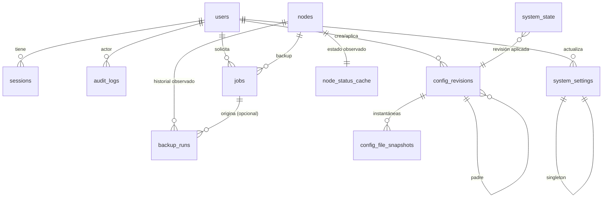
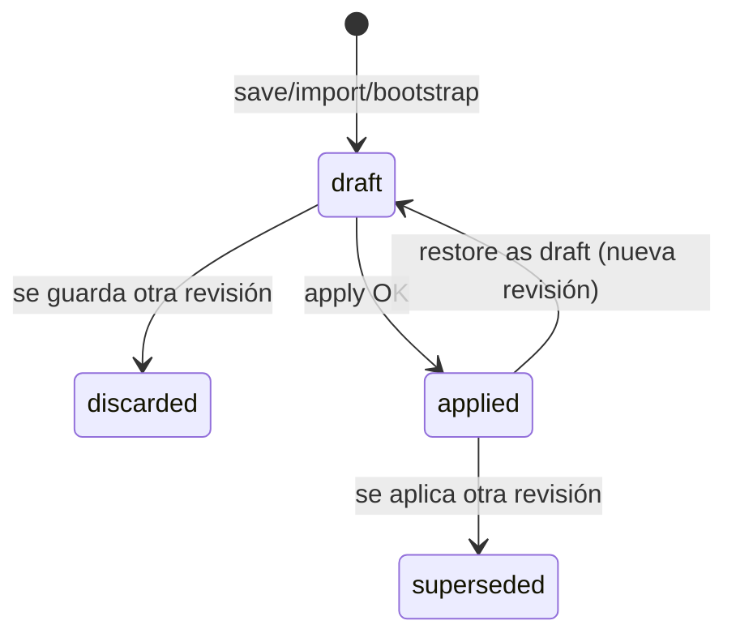

# Modelo de datos (Fase 1)

Motor: SQLite 3 con SQLAlchemy 2 (síncrono) y migraciones Alembic.
Base de datos: `/data/oxidized-ui.sqlite3` (volumen `ui_data`).

Decisiones transversales:

- Todas las fechas se guardan en **UTC** (`DateTime(timezone=True)` en el modelo;
  SQLite no conserva tzinfo, así que la capa de acceso normaliza siempre a UTC).
  La API serializa ISO-8601 con sufijo `Z`.
- Los booleanos se guardan como `INTEGER 0/1`.
- Las claves primarias son enteros autoincrementales salvo `system_state`,
  `system_settings` y `node_status_cache`, que usan claves singleton/1:1.
- `PRAGMA foreign_keys=ON`, `journal_mode=WAL`, `busy_timeout=5000` y
  `synchronous=NORMAL` al abrir cada conexión. Un solo worker de Uvicorn.
- Los secretos cifrados son tokens Fernet en columnas `TEXT` (ASCII). Nunca se
  guardan en claro en la base de datos, en WAL, en logs ni en auditoría.
- Las revisiones de configuración son inmutables. La historia no se actualiza;
  un rollback crea una revisión nueva.
- Solo existe un borrador de configuración activo a la vez, protegido con
  concurrencia optimista (`expected_revision_id`).

## Diagrama entidad-relación

`groups` no es una tabla: vive dentro del JSON de configuración (sección
`groups`). Los nodos referencian el grupo por `group_name`. Se valida contra los
grupos de la revisión **aplicada**, no contra el borrador. No se crea una tabla
duplicada para evitar dos fuentes de verdad.

## users

| Columna | Tipo | Restricciones / notas |
|---|---|---|
| `id` | INTEGER | PK |
| `username` | TEXT | NOT NULL, 3–64, `[A-Za-z0-9._-]`; se conserva el casing |
| `username_key` | TEXT | NOT NULL, UNIQUE; `casefold()` para unicidad case-insensitive |
| `password_hash` | TEXT | NOT NULL; Argon2id |
| `role` | TEXT | NOT NULL; `admin`, `operator`, `viewer` |
| `language` | TEXT | NOT NULL; código ISO disponible; default `DEFAULT_LANGUAGE` |
| `theme` | TEXT | NOT NULL; `light`, `dark`, `system`; default `system` |
| `is_active` | INTEGER | NOT NULL default 1 |
| `created_at` | DATETIME | NOT NULL |
| `updated_at` | DATETIME | NOT NULL |
| `last_login_at` | DATETIME | NULL |
| `password_changed_at` | DATETIME | NOT NULL |

Reglas de negocio:

- No se puede desactivar, degradar ni borrar al último admin activo.
- Un admin no puede borrarse a sí mismo.
- Al desactivar/cambiar rol/contraseña de un usuario se revocan sus sesiones
  (excepto la sesión actual si el usuario cambia su propia contraseña; esa se
  rota).
- El usuario `BOOTSTRAP_ADMIN_*` se crea solo si la tabla está vacía. La
  contraseña de entorno no se persiste aparte.
- El cambio de idioma/tema se hace en `PATCH /api/me`; solo afecta al usuario
  autenticado.

## sessions

| Columna | Tipo | Restricciones / notas |
|---|---|---|
| `id` | INTEGER | PK |
| `user_id` | INTEGER | FK `users.id` ON DELETE CASCADE, NOT NULL |
| `token_hash` | TEXT | NOT NULL UNIQUE; SHA-256 hex del token de cookie |
| `created_at` | DATETIME | NOT NULL |
| `last_seen_at` | DATETIME | NOT NULL |
| `expires_at` | DATETIME | NOT NULL (absoluta) |
| `revoked_at` | DATETIME | NULL |
| `ip` | TEXT | NULL, truncado |
| `user_agent` | TEXT | NULL, truncado a 512 |

Índices: `(user_id)`, `(expires_at)`, `(revoked_at)`.

- Cookie: token aleatorio de 32 bytes, valor opaco. Solo se almacena su hash.
- Expiración absoluta de 12 h y expiración por inactividad de 30 min en esta
  versión, implementadas con `expires_at`/`last_seen_at`. No son configurables
  desde la UI; se documentan como constantes de seguridad.
- El CSRF token no se guarda: se deriva con HMAC-SHA256(`SECRET_KEY`,
  token de sesión) y se devuelve al frontend en `/api/auth/session`.
- El token de sesión nunca aparece en logs ni auditoría.
- Un usuario inactivo no puede autenticarse ni reutilizar una sesión.

## login_attempts

| Columna | Tipo | Restricciones / notas |
|---|---|---|
| `id` | INTEGER | PK |
| `username_key` | TEXT | NOT NULL |
| `ip` | TEXT | NOT NULL |
| `succeeded` | INTEGER | NOT NULL |
| `created_at` | DATETIME | NOT NULL |

Índices: `(ip, created_at)`, `(username_key, created_at)`, `(created_at)`.

- Ventana deslizante: 5 fallos por IP+usuario / 15 min y 20 fallos por IP /
  15 min (valores configurables en código, documentados en README). Al superar
  el límite: `429 auth.too_many_attempts` con `Retry-After`.
- Se limpian intentos de más de 30 días o fuera de la ventana en cada login.
- No se guarda la contraseña ni un hash de ella.

## nodes

| Columna | Tipo | Restricciones / notas |
|---|---|---|
| `id` | INTEGER | PK |
| `name` | TEXT | NOT NULL; nombre visible, seguro para logs/rutas |
| `name_key` | TEXT | NOT NULL UNIQUE; `casefold()` de `name` |
| `address` | TEXT | NULL; IP o hostname |
| `model` | TEXT | NOT NULL; catálogo o modelo personalizado |
| `group_name` | TEXT | NULL; grupo de la config aplicada |
| `input` | TEXT | NULL; lista ordenada separada por comas (`ssh, telnet`) |
| `port` | INTEGER | NULL; 1–65535; se traduce a `ssh_port` y/o `telnet_port` |
| `username` | TEXT | NULL; credencial de login (visible a admin/operator) |
| `password_ciphertext` | TEXT | NULL; Fernet; write-only |
| `enable_ciphertext` | TEXT | NULL; Fernet; write-only; se envía como `vars.enable` |
| `vars_ciphertext` | TEXT | NULL; JSON cifrado con Fernet; variables arbitrarias |
| `output` | TEXT | NULL; override opcional avanzado |
| `prompt` | TEXT | NULL; override opcional avanzado |
| `timeout_seconds` | INTEGER | NULL; override opcional, 1–3600 |
| `created_at` | DATETIME | NOT NULL |
| `updated_at` | DATETIME | NOT NULL |
| `created_by_id` | INTEGER | FK `users.id` ON DELETE SET NULL |
| `updated_by_id` | INTEGER | FK `users.id` ON DELETE SET NULL |

Índices: `UNIQUE(name_key)`, `(group_name)`, `(model)`, `(name_key)`.

Reglas:

- `name` no vacío, ≤ 253, sin `/`, `\`, caracteres de control ni
  `..`; no puede terminar en `.json` (ambigüedad de rutas de oxidized-web).
- `group_name` debe existir en la configuración aplicada o ser `NULL`. Se
  revalida al aplicar una configuración que elimine/renombre grupos.
- `model` se valida contra el catálogo estático de 0.37.0, pero se acepta un
  modelo personalizado si no está en el catálogo (warning en UI).
- `input` permite únicamente inputs conocidos (`ssh`, `telnet`, `scp`, `ftp`,
  `http`, `tftp`, `exec`) y como máximo uno de cada.
- `port`: si el input incluye SSH/SCP se emite `vars.ssh_port`; si incluye
  Telnet se emite `vars.telnet_port`. Con ambos se emiten los dos. Para
  FTP/TFTP/HTTP/EXEC no hay puerto genérico en Oxidized y la UI lo explica.
- `vars_ciphertext` contiene un objeto JSON. Se prohíben claves reservadas:
  `enable`, `password`, `username`, `name`, `ip`, `model`, `group`. `enable` es
  una columna propia.
- La API nunca devuelve `password_ciphertext`, `enable_ciphertext` ni
  `vars_ciphertext` descifrado. Devuelve `has_password`, `has_enable` y (según
  rol) `vars` si el rol puede verlas. Viewer no ve vars ni username.
- Para actualizar:
  - `password` omitido → se conserva;
  - `password: "nuevo"` → se reemplaza;
  - `clear_password: true` → se borra.
  Igual para `enable`.
- Borrar un nodo no borra los datos históricos de Oxidized en el repo git. La UI
  lo advierte. Los `backup_runs` observados se conservan con un snapshot del
  nombre y `node_id = NULL`.

## node_status_cache

| Columna | Tipo | Restricciones / notas |
|---|---|---|
| `node_id` | INTEGER | PK, FK `nodes.id` ON DELETE CASCADE |
| `status` | TEXT | NULL; `success`, `no_connection`, `fail`, `timelimit` o desconocido |
| `last_started_at` | DATETIME | NULL |
| `last_finished_at` | DATETIME | NULL |
| `last_success_at` | DATETIME | NULL |
| `last_failure_at` | DATETIME | NULL |
| `duration_seconds` | INTEGER | NULL |
| `oxidized_mtime` | DATETIME | NULL |
| `observed_at` | DATETIME | NOT NULL |
| `raw_last_json` | TEXT | NULL; último `last` normalizado, sin secretos |

Es una caché de observación, no la fuente de verdad de los backups. Se actualiza
desde `/nodes.json`. Los estados desconocidos se muestran como fallo genérico,
sin inventar un estado.

## backup_runs

| Columna | Tipo | Restricciones / notas |
|---|---|---|
| `id` | INTEGER | PK |
| `node_id` | INTEGER | NULL, FK `nodes.id` ON DELETE SET NULL |
| `node_name` | TEXT | NOT NULL; snapshot al observar |
| `group_name` | TEXT | NULL; snapshot |
| `started_at` | DATETIME | NOT NULL |
| `finished_at` | DATETIME | NULL |
| `duration_seconds` | INTEGER | NULL |
| `status` | TEXT | NOT NULL |
| `trigger` | TEXT | NOT NULL; `observed` o `manual_ui` |
| `job_id` | INTEGER | NULL, FK `jobs.id` ON DELETE SET NULL |
| `dedupe_key` | TEXT | NOT NULL UNIQUE |
| `observed_at` | DATETIME | NOT NULL |

Índices: `(finished_at)`, `(node_id, finished_at)`, `(status, finished_at)`.

- `dedupe_key = sha256(node_id + started_at + finished_at + status)` para no
  duplicar la misma observación en cada poll.
- `manual_ui` se usa para el backup solicitado desde la UI cuando se puede
  correlacionar con un job; el estado real sigue viniendo de Oxidized.
- Retención configurable (90 días por defecto). Es la base del gráfico de
  actividad; se documenta que es una observación periódica.

## jobs

| Columna | Tipo | Restricciones / notas |
|---|---|---|
| `id` | INTEGER | PK |
| `kind` | TEXT | NOT NULL; `backup_node`, `backup_all`, `oxidized_reload`, `oxidized_restart`, `config_apply` |
| `status` | TEXT | NOT NULL; `queued`, `running`, `succeeded`, `failed`, `cancelled` |
| `node_id` | INTEGER | NULL, FK `nodes.id` ON DELETE SET NULL |
| `created_by_id` | INTEGER | NULL, FK `users.id` ON DELETE SET NULL |
| `progress_total` | INTEGER | NOT NULL default 0 |
| `progress_done` | INTEGER | NOT NULL default 0 |
| `payload_json` | TEXT | NOT NULL default `{}`; sin secretos |
| `result_json` | TEXT | NULL; conteos, estado final sin secretos |
| `error_code` | TEXT | NULL |
| `error_params_json` | TEXT | NULL |
| `created_at` | DATETIME | NOT NULL |
| `started_at` | DATETIME | NULL |
| `finished_at` | DATETIME | NULL |

Índices: `(status, created_at)`, `(kind, created_at)`, `(node_id)`.

- `backup_all` es un único job con progreso, no N jobs. `backup_node` es un job
  con `node_id`.
- `payload_json` solo incluye IDs, nombres y flags; nunca credenciales ni
  contenido de config.
- Al arrancar, los jobs `queued`/`running` de la ejecución anterior se marcan
  `failed` con `job.interrupted` (proceso en memoria). El estado final real de
  un backup se reconcilia con el poller.
- No se permite más de un `backup_all` activo (comprobación en servicio con
  índice parcial único si SQLite lo permite; si no, lock de aplicación).

## config_revisions

| Columna | Tipo | Restricciones / notas |
|---|---|---|
| `id` | INTEGER | PK; número de revisión visible |
| `parent_id` | INTEGER | NULL, FK `config_revisions.id` ON DELETE SET NULL |
| `status` | TEXT | NOT NULL; `draft`, `applied`, `superseded`, `discarded` |
| `origin` | TEXT | NOT NULL; `bootstrap`, `form`, `yaml`, `groups`, `rollback`, `external_import` |
| `config_ciphertext` | TEXT | NOT NULL; JSON canónico cifrado |
| `yaml_ciphertext` | TEXT | NOT NULL; YAML efectivo cifrado |
| `config_sha256` | TEXT | NOT NULL |
| `yaml_sha256` | TEXT | NOT NULL |
| `note` | TEXT | NULL; máx. 500 |
| `created_by_id` | INTEGER | NULL, FK `users.id` ON DELETE SET NULL |
| `created_at` | DATETIME | NOT NULL |
| `applied_by_id` | INTEGER | NULL, FK `users.id` ON DELETE SET NULL |
| `applied_at` | DATETIME | NULL |
| `file_written_at` | DATETIME | NULL |
| `file_written_sha256` | TEXT | NULL |

Índices: `(status, created_at)`, `(created_at)`.

Estados:

Si un apply falla, la revisión sigue en `draft`; el fallo se registra en el job,
en `system_state.last_apply_error_code` y en auditoría. La revisión aplicada
anterior nunca se modifica.

- Solo una revisión `draft` activa. El backend devuelve `config.stale_draft` si
  `expected_revision_id` no coincide.
- Al aplicar una revisión, la anterior `applied` pasa a `superseded` en la misma
  transacción y `system_state.active_revision_id` apunta a la nueva.
- `config_ciphertext` contiene el JSON completo **editable** (sin los bloques
  gestionados de source/extensions) más extras desconocidos. `yaml_ciphertext`
  contiene el YAML efectivo con los bloques gestionados inyectados y el token de
  source. Ambos se cifran con Fernet.
- La API de configuración es solo admin. Devuelve el JSON desencriptado y el YAML
  para edición. El token de source se enmascara en las respuestas y no se puede
  modificar.
- Restaurar una revisión antigua crea una revisión nueva con `parent_id` de la
  original y estado `draft`; no cambia el estado de la original.

## config_file_snapshots

| Columna | Tipo | Restricciones / notas |
|---|---|---|
| `id` | INTEGER | PK |
| `revision_id` | INTEGER | NULL, FK `config_revisions.id` ON DELETE SET NULL |
| `reason` | TEXT | NOT NULL; `pre_apply`, `drift`, `external_import`, `rollback_restore` |
| `yaml_ciphertext` | TEXT | NOT NULL; copia exacta del fichero |
| `sha256` | TEXT | NOT NULL |
| `captured_by_id` | INTEGER | NULL, FK `users.id` ON DELETE SET NULL |
| `captured_at` | DATETIME | NOT NULL |

- Se captura el fichero antes de sobrescribirlo si su hash no coincide con el
  esperado (drift) o al importar un fichero externo.
- Permite recuperar contenido que no parsea como YAML válido (por eso no se
  guarda solo como revisión estructurada).
- La copia en `.ui-backups/` del volumen es texto plano (Oxidized debe leer el
  fichero activo; los backups son de recuperación manual) con permisos 0600.
  La copia en SQLite está cifrada.

## system_state

Fila singleton `id = 1`.

| Columna | Tipo | Notas |
|---|---|---|
| `id` | INTEGER | PK, CHECK `id = 1` |
| `setup_completed_at` | DATETIME | NULL hasta crear el primer admin |
| `initialized_at` | DATETIME | NOT NULL |
| `app_instance_id` | TEXT | UUID; diagnóstico |
| `active_revision_id` | INTEGER | NULL, FK `config_revisions.id` ON DELETE SET NULL |
| `active_file_sha256` | TEXT | NULL; hash del fichero tras el último apply |
| `drift_detected_at` | DATETIME | NULL |
| `last_oxidized_seen_at` | DATETIME | NULL |
| `last_apply_error_code` | TEXT | NULL |

- `drift_detected_at` se limpia al aplicar o importar la deriva.
- No guarda secretos.
- El bootstrap de configuración crea la primera revisión y actualiza
  `active_revision_id` aunque todavía no exista admin (`created_by_id = NULL`).

## system_settings

Fila singleton `id = 1`.

| Columna | Tipo | Notas |
|---|---|---|
| `id` | INTEGER | PK, CHECK `id = 1` |
| `oxidized_api_url` | TEXT | default de `OXIDIZED_API_URL`; validada http(s) |
| `oxidized_container_name` | TEXT | default de `OXIDIZED_CONTAINER_NAME`; `[A-Za-z0-9_.-]+` |
| `docker_proxy_url` | TEXT | default de `DOCKER_PROXY_URL`; validada http(s) |
| `timezone` | TEXT | NULL = zona del navegador; si se fija, IANA validada |
| `activity_retention_days` | INTEGER | 7–365; default 90 |
| `poll_interval_seconds` | INTEGER | 15–300; default 30 |
| `log_tail_default` | INTEGER | 100–5000; default 500 |
| `config_backup_keep` | INTEGER | 5–200; default 50 |
| `updated_by_id` | INTEGER | FK `users.id` ON DELETE SET NULL |
| `updated_at` | DATETIME | NOT NULL |

Reglas:

- Solo admin.
- Los valores se siembran desde el entorno la primera vez. La resolución de
  conexión efectiva es: valor de BD si existe, si no variable de entorno. La UI
  deja claro qué valor está en uso.
- Cambiar `oxidized_api_url` no cambia el source HTTP generado (ese es interno).
  Tras cambiarlo, la UI hace un test de conexión y muestra el resultado.
- Cambiar la contraseña o la clave de cifrado no se hace desde esta pantalla.
- El test de conexión tiene timeout corto y no devuelve cuerpos internos.

## audit_logs

| Columna | Tipo | Restricciones / notas |
|---|---|---|
| `id` | INTEGER | PK |
| `actor_user_id` | INTEGER | NULL, FK `users.id` ON DELETE SET NULL |
| `actor_username` | TEXT | NOT NULL; snapshot |
| `actor_role` | TEXT | NOT NULL; snapshot |
| `action_code` | TEXT | NOT NULL; p. ej. `node.created` |
| `action_params_json` | TEXT | NOT NULL default `{}`; solo parámetros no sensibles |
| `target_type` | TEXT | NULL; `node`, `config`, `user`, `oxidized`, `system` |
| `target_id` | TEXT | NULL |
| `ip` | TEXT | NULL |
| `user_agent` | TEXT | NULL |
| `created_at` | DATETIME | NOT NULL |

Índices: `(created_at)`, `(actor_user_id, created_at)`,
`(action_code, created_at)`, `(target_type, target_id)`.

- Las acciones del sistema (bootstrap, poller, recuperación automática) usan
  `actor_username = "system"`, `actor_user_id = NULL` y rol `system`.
- **Nunca** se guardan contraseñas, tokens, valores de vars, cuerpos de
  peticiones, diffs ni YAML. Para cambios de config se guardan ids de revisión y
  nombres de secciones afectadas.
- Códigos iniciales:
  - `auth.login_succeeded`, `auth.login_failed`, `auth.logout`,
    `auth.password_changed`, `auth.rate_limited`;
  - `setup.completed`, `setup.bootstrap_admin`;
  - `node.created`, `node.updated`, `node.deleted`, `node.bulk_updated`,
    `node.imported`, `node.exported`, `node.backup_requested`;
  - `group.created`, `group.updated`, `group.deleted`;
  - `config.draft_saved`, `config.applied`, `config.apply_failed`,
    `config.drift_detected`, `config.external_imported`;
  - `oxidized.reload_requested`, `oxidized.restart_requested`,
    `oxidized.auto_recovered`;
  - `user.created`, `user.updated`, `user.deleted`, `user.password_reset`;
  - `system.settings_updated`, `system.connection_test`;
  - `job.failed`, `job.interrupted`.
- La UI traduce `audit.action.<code>` con los parámetros. El test de i18n cubre
  todos los códigos.
- Retención: 180 días por defecto; la limpieza se ejecuta a diario. La UI de
  auditoría es solo admin.

## Cifrado y gestión de claves

| Dato | Protección |
|---|---|
| Contraseñas de usuarios | Argon2id; nunca reversible |
| Token de sesión | Hash SHA-256 en BD; valor original solo en cookie HttpOnly |
| CSRF token | Derivado HMAC de la sesión; no almacenado |
| Password/enable de nodo | Fernet por campo |
| Vars de nodo | JSON completo cifrado con Fernet |
| Configuración de Oxidized (JSON y YAML) | Fernet en cada revisión y snapshot |
| Fichero `config` compartido | Texto plano por exigencia de Oxidized; permisos 0640, volumen de confianza |
| Copias `.ui-backups/` | Texto plano; permisos 0600; rotación por `CONFIG_BACKUP_KEEP` |
| Token del source HTTP | Variable de entorno; se inyecta en el YAML; nunca se devuelve |
| Secretos en auditoría/logs | Prohibidos por diseño |

- `FERNET_KEY` debe ser una clave Fernet válida y estable. Si se pierde, las
  credenciales de nodo y las revisiones cifradas no se pueden descifrar.
- No hay rotación automática de `FERNET_KEY` en esta versión; el README
  documentará cómo hacer backup y por qué no se debe rotar a la ligera.
- Las revisiones antiguas cifradas con la misma clave siguen siendo legibles.

## Datos derivados (no persistidos como fuente de verdad)

- Contadores del dashboard: se calculan con `nodes`, `node_status_cache`,
  `backup_runs` y jobs activos.
- Lista de grupos: se extrae de la revisión aplicada.
- Actividad: agregación de `backup_runs` por día.
- Estado del contenedor: se consulta en vivo a Docker; no se persiste.
- Modelos disponibles: catálogo estático (`app/data/oxidized_models.json`).

## Retención y mantenimiento

| Dato | Retención |
|---|---|
| Sesiones expiradas/revocadas | Se purgan a diario y al arrancar |
| Intentos de login | 30 días / ventana activa |
| `backup_runs` | 90 días configurable |
| Jobs terminados | 30 días |
| Auditoría | 180 días |
| Revisiones de configuración | Indefinida (no se borran desde la UI) |
| Snapshots de fichero | Sujetos a `CONFIG_BACKUP_KEEP` en disco; en BD se conservan |
| Logs | Los gestiona Docker con rotación (`max-size`, `max-file`) |

## Migraciones

- Alembic se ejecuta al arrancar la UI (`alembic upgrade head`) antes de aceptar
  tráfico; el healthcheck no responde 200 hasta que termina.
- Prohibido `create_all` en producción. En tests se puede usar el metadata para
  crear el esquema en una BD temporal, pero las migraciones se prueban en CI.
- El primer arranque crea la fila singleton de `system_state` y
  `system_settings` si no existen.
